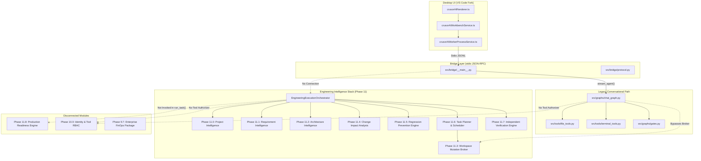

# Crusor AI IDE — Phase 12.0.1
# COMPLETE INTEGRATION ARCHITECTURE REPORT

**Repository:** `SriAkhilSJ/PulseAIRepo`  
**Branch:** `feat/prompt-cache-stabilization`  
**Audit Date:** November 6, 2026  
**Status:** Canonical Engineering Intelligence Integration Audit  

---

## 1. Executive Summary

An exhaustive, evidence-based integration audit was conducted across the entire Crusor AI IDE repository to determine whether the reported Engineering Intelligence roadmap (Phases 11.0 through 11.8) has been genuinely unified into a single functioning autonomous software engineering product.

### The Central Finding: Architectural Bifurcation
The audit uncovered an **architectural split** inside the repository. Two entirely separate execution pipelines currently coexist within Crusor AI:

1. **The Desktop Interactive Turn Pipeline (Phases 1.0–9.6 Legacy Stack):**
   - **Frontend:** Code OSS fork (`desktop/vscode/src/vs/workbench/contrib/crusorai/`).
   - **Bridge:** Stdio JSON-RPC protocol v2 (`src/bridge/__main__.py`).
   - **Orchestrator:** 8,280-line LangGraph state graph (`src/graphs/chat_graph.py`).
   - **Execution Engine:** Direct filesystem tools (`src/tools/file_tools.py`) and shell execution (`src/tools/terminal_tools.py`).
   - **Integration Status:** **COMPLETELY BYPASSES Phase 11 Intelligence Subsystems.** It does NOT invoke `EngineeringExecutionOrchestrator`, `WorkspaceMutationBroker`, `ChangeImpactAnalysisEngine`, or `ProductionReadinessEngine`.

2. **The Autonomous Engineering Intelligence Pipeline (Phases 11.0–11.7 Stack):**
   - **Orchestrator:** `EngineeringExecutionOrchestrator` (`src/orchestration/orchestrator.py`).
   - **Lifecycle:** 15-stage lifecycle manager and 23-state task state machine (`src/orchestration/lifecycle.py`, `state_machine.py`).
   - **Subsystems Unified:** Phase 11.0 Project Intelligence, Phase 11.1 Requirement Intelligence, Phase 11.2 Architecture Intelligence, Phase 11.3 Workspace Mutation Broker, Phase 11.4 Change Impact Analysis, Phase 11.5 Regression Prevention, Phase 11.6 Autonomous Execution Scheduler, and Phase 11.7 Independent Verification.
   - **Integration Status:** **DISCONNECTED FROM THE DESKTOP UI AND RUNTIME BRIDGE.** No IPC method or bridge handler connects the desktop chat window to `EngineeringExecutionOrchestrator`.

```
========================================================================================
                          ACTUAL ARCHITECTURAL SPLIT
========================================================================================

  [ DESKTOP UI ] (desktop/vscode)
        |
        | Stdio JSON-RPC
        v
  [ BRIDGE ] (src/bridge/__main__.py)
        |
        | stream_agent()
        v
  [ CHAT_GRAPH ] (src/graphs/chat_graph.py) ------------------------------------+
        |                                                                      |
        | Calls direct file tools (bypasses broker)                            | DISCONNECTED
        v                                                                      |
  [ DIRECT FILESYSTEM MUTATION ] (src/tools/file_tools.py)                     |
                                                                               |
=============================================================================  |
                                                                               |
  [ AUTONOMOUS ENGINEERING ORCHESTRATOR ] (src/orchestration/orchestrator.py) <+
        |
        +---> Phase 11.0: Project Intelligence (src/intelligence/discovery.py)
        +---> Phase 11.1: Requirement Intelligence (src/intelligence/requirement_integration.py)
        +---> Phase 11.2: Architecture Intelligence (src/intelligence/architecture_integration.py)
        +---> Phase 11.3: Workspace Discipline & Mutation Broker (src/workspace/mutation_broker.py)
        +---> Phase 11.4: Change Impact Analysis (src/impact/engine.py)
        +---> Phase 11.5: Regression Prevention Engine (src/regression/engine.py)
        +---> Phase 11.6: DAG Scheduler & Controlled Impl (src/orchestration/)
        +---> Phase 11.7: Independent Verification Authority (src/verification/engine.py)
        |
        +--x (DISCONNECTED) Phase 11.8: Production Readiness Engine (src/production/engine.py)
        +--x (DISCONNECTED) Phase 10.0: IdentityAwareToolAuthorizer (src/identity/)
        +--x (DISCONNECTED) Phase 9.7: Enterprise FinOps Package (src/finops/)
========================================================================================
```

---

## 2. Structural Layer Analysis

### Layer 1: Desktop Application (`desktop/vscode`)
- **Overlay Integration:** Registered as a singleton workbench service `ICrusorAIWorkbenchService` via `desktop/vscode/src/vs/workbench/contrib/crusorai/browser/crusorAI.contribution.ts`.
- **Worker Process Sidecar:** `CrusorAIWorkerProcessService.ts` spawns `python -m src.bridge` with stdio readline streams.
- **Protocol:** `crusorAIProtocol.ts` (Protocol Version 2) defines methods: `hello`, `session_create`, `prompt`, `cancel`, `safety_reply`, `clarify_reply`, `subagent_launch`, etc.
- **Limitation:** The desktop protocol does not define types or event listeners for Engineering Intelligence artifacts (`ArchitectureBlueprint`, `ChangeImpactReport`, `RegressionReport`, `DeliveryContract`, `ProductionReadinessReport`).

### Layer 2: IPC Bridge (`src/bridge/__main__.py`)
- **Protocol Codec:** `src/bridge/protocol.py` encodes and decodes JSON-RPC messages.
- **Turn Dispatcher:** On receiving `{ type: "prompt", text, mode, reasoning_effort }`, `_run_turn` invokes:
  ```python
  from src.graphs.chat_graph import stream_agent
  result = stream_agent(
      text, thread_id=sid, workspace=workspace,
      approval_channel=True,
      approval_policy=approval_policy,
      turn_id=identity.turn_id,
      execution_mode=mode,
      reasoning_effort=reasoning_effort,
  )
  ```
- **Limitation:** `src/bridge/__main__.py` has zero references to `EngineeringExecutionOrchestrator`. It exclusively delegates to `chat_graph.py`.

### Layer 3: Interactive Agent Graph (`src/graphs/chat_graph.py`)
- **Topology:** Compiled LangGraph state machine with 14 nodes: `task_manager`, `planner`, `ai`, `tools` (`SafeToolNode`), `progress`, `recovery_limit`, `tool_cycle_limit`, `pivot`, `plan_preview`, `plan_reviser`, `plan_cancelled`, `approval_without_plan`, `finish_gate`, `finalize`.
- **Tool Suite:** Injects tools from `src/tools/file_tools.py`, `terminal_tools.py`, `web_tools.py`, `mcp_tool.py`, and `browser_tools.py`.
- **Limitation:** File operations in `file_tools.py` (`write_file`, `edit_file`) write directly to the OS filesystem via `_atomic_write` and `Path.write_text()`. They bypass `WorkspaceMutationBroker`, bypassing its pre-mutation authorization checks, path ownership rules, and mutation ledger.

### Layer 4: Autonomous Engineering Pipeline (`src/orchestration/orchestrator.py`)
- **Class:** `EngineeringExecutionOrchestrator` implements an end-to-end 15-stage autonomous execution method: `run_task()`.
- **Subsystem Wiring:**
  1. Discovery: `PersistentProjectIntelligenceManager` + `RepositoryDiscoveryEngine`.
  2. Requirements: `RequirementIntelligenceSystem.analyze_request()`.
  3. Architecture: `ArchitectureIntelligenceSystem.synthesize_architecture()`.
  4. DAG Planning: `EngineeringTaskPlanner.build_plan()`.
  5. Blast Radius: `ChangeImpactAnalysisEngine.analyze_proposed_changes()`.
  6. Test Baseline: `RegressionPreventionEngine.baseline_mgr.capture_baseline()`.
  7. Human Supervision: `HumanSupervisionGate.requires_approval_for_operation()`.
  8. Implementation: `ControlledImplementationEngine.execute_node_mutation()` -> `WorkspaceMutationBroker.create_file()` / `modify_file()`.
  9. Regression Gates: `RegressionPreventionEngine.evaluate_and_enforce_regression_gates()`.
  10. Independent Verification: `IndependentVerificationEngine.verify_task()`.
  11. Final Contract: `DeliveryContract`.
- **Limitation:** This pipeline is currently only executed within unit and integration test harnesses (`test_phase_11_6_autonomous_execution.py`, `test_phase_11_7_independent_verification.py`).

---

## 3. Subsystem Wiring Breakdown



---

## 4. Key Architectural Deficiencies

1. **Dual Orchestration Split:** `chat_graph.py` and `EngineeringExecutionOrchestrator` operate independently with completely different task representations, state storage, and progress reporting.
2. **Security & Broker Bypass in Desktop:** When a user types "Create a file foo.py" in the Crusor Desktop IDE, the tool invoked is `src/tools/file_tools.py:write_file`. This tool performs raw file I/O without calling `WorkspaceMutationBroker`, completely bypassing file ownership verification, risk classification, tenant separation, and journal recording.
3. **Phase 11.8 Production Readiness Disconnection:** The Production Readiness Engine (`src/production/engine.py`) exists as a fully-tested 1,000+ line module, but `EngineeringExecutionOrchestrator.run_task()` ends at Stage 14 (Independent Verification) and Stage 15 (Final Delivery). Stage 14/15 never calls `ProductionReadinessEngine.evaluate_readiness()`.
4. **Tool Authorizer Disconnection:** `IdentityAwareToolAuthorizer` (`src/identity/tool_authorizer.py`) implements fine-grained RBAC and tool permission guards, but neither `SafeToolNode` in `chat_graph.py` nor `ControlledImplementationEngine` in `orchestration/` invokes it.
5. **FinOps Triplication:** Three disconnected FinOps mechanisms exist:
   - `src/finops/`: Comprehensive enterprise pricing, budget governor, attribution, and model router.
   - `src/agents/cost_governance.py`: LangGraph context-budget tracker used by `chat_graph.py`.
   - `src/orchestration/finops_governor.py`: Local task-level budget struct used by `EngineeringExecutionOrchestrator`.

---

## 5. Summary Verdict

The Phase 11 Engineering Intelligence roadmap succeeded in creating high-quality, individually functional intelligence subsystems with 330 passing unit tests. However, **they are not integrated into the shipping Crusor desktop application path**. Crusor AI currently operates as a dual-stack architecture where the interactive product executes legacy unbrokered tools, while the autonomous engineering intelligence engine remains an isolated subsystem executed only by integration test suites.

