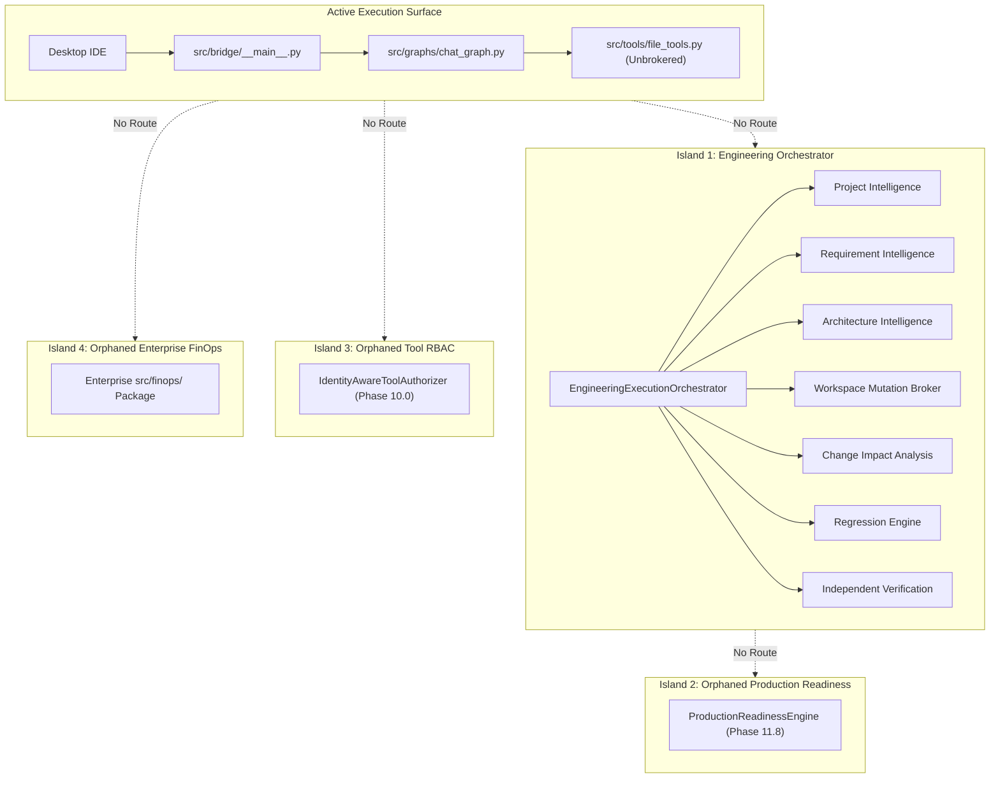

# Crusor AI IDE — Phase 12.0.1
# DISCONNECTED COMPONENTS REPORT

**Repository:** `SriAkhilSJ/PulseAIRepo`  
**Branch:** `feat/prompt-cache-stabilization`  
**Audit Date:** November 6, 2026  
**Scope:** Inventory of Isolated, Unwired, or Orphaned Subsystems in the Codebase  

---

## 1. Executive Summary

This report identifies all subsystems, modules, and classes across Phases 9.3 through 11.8 that exist in the repository with passing test suites, but are **completely disconnected from the actual application execution paths**.

A class existing in the repository is not proof of integration. The audit uncovered five major architectural disconnections.

---

## 2. Inventory of Disconnected Components

### Disconnected Component 1: Production Readiness Engine (Phase 11.8)
- **Module Location:** `src/production/`
  - `engine.py:ProductionReadinessEngine`
  - `gate.py:ProductionReadinessGate`
  - `security.py:SecurityReadinessAnalyzer`
  - `reliability.py:ReliabilityResilienceAnalyzer`
  - `performance.py:PerformanceCapacityAnalyzer`
  - `rollback.py:RollbackRecoveryPlanner`
  - `supply_chain.py:SupplyChainDependencyAnalyzer`
  - `profile.py:TargetEnvironmentProfiler`
  - `remediation.py:ReadinessRemediationPlanner`
- **Current State:** Has 70 comprehensive unit tests in `src/tests/test_phase_11_8_production_readiness.py`, all passing.
- **Root Cause of Disconnection:**
  - `src/orchestration/orchestrator.py` defines the 15 lifecycle stages in `TaskLifecycleStage`.
  - In `orchestrator.py:run_task()`, Stage 14 is defined as `REGRESSION_VERIFICATION & INDEPENDENT VERIFICATION`, and Stage 15 is `FINAL_DELIVERY`.
  - `ProductionReadinessEngine` is **NOT imported, instantiated, or invoked anywhere in `EngineeringExecutionOrchestrator`**.
  - `src/bridge/__main__.py` and `src/graphs/chat_graph.py` also have zero references to `ProductionReadinessEngine`.
- **Impact:** Crusor AI claims to possess production readiness assessment capabilities, but the engine is 100% disconnected from the execution pipeline. Tasks complete and deliver without ever evaluating production readiness.

---

### Disconnected Component 2: Identity-Aware Tool Authorizer & Enterprise RBAC (Phase 10.0)
- **Module Location:** `src/identity/`
  - `tool_authorizer.py:IdentityAwareToolAuthorizer`
  - `authorization.py:RBACPolicyEngine`
  - `roles.py:EnterpriseRoleHierarchy`
  - `tenancy.py:TenantBoundaryEnforcer`
  - `resource_guard.py:ResourceAccessController`
- **Current State:** Comprehensive enterprise RBAC test suite passes (`test_phase_10_0_enterprise_identity_rbac.py`).
- **Root Cause of Disconnection:**
  - `chat_graph.py:SafeToolNode` handles tool execution via legacy `src/context/safety_guard.py:SafetyGuard` and `detect_dangerous_command()`. It never calls `IdentityAwareToolAuthorizer.authorize_tool_call()`.
  - `ControlledImplementationEngine` in `src/orchestration/implementation_engine.py` validates node target paths, but does not query `IdentityAwareToolAuthorizer` for user role or permission checks.
  - Across the entire `src/` codebase, `IdentityAwareToolAuthorizer` is only imported in `src/identity/__init__.py` and its own unit test.
- **Impact:** Enterprise RBAC policies, role hierarchies, and tool-level permissions are unenforced in both execution paths.

---

### Disconnected Component 3: Enterprise FinOps Package (Phase 9.7)
- **Module Location:** `src/finops/`
  - `pricing_registry.py:ModelPricingRegistry`
  - `accounting.py:TokenAccountingEngine`
  - `budget_governor.py:BudgetGovernor`
  - `model_router.py:CostOptimizedModelRouter`
  - `credits.py:CreditAccountingEngine`
  - `attribution.py:CostAttributionEngine`
  - `context_optimizer.py:ContextCostOptimizer`
- **Current State:** 35 passing unit tests in `test_phase_9_7_enterprise_finops.py`.
- **Root Cause of Disconnection:**
  - Neither `src/graphs/chat_graph.py` nor `src/orchestration/orchestrator.py` imports `src/finops`.
  - `chat_graph.py` uses `src/agents/cost_governance.py` and `src/context/token_tracker.py`.
  - `EngineeringExecutionOrchestrator` uses `src/orchestration/finops_governor.py:OrchestrationFinOpsGovernor`, which implements an isolated, self-contained `TaskFinOpsExpenditure` dataclass without using `src/finops/pricing_registry.py` or `TokenAccountingEngine`.
- **Impact:** The enterprise pricing registry, multi-tier cost router, and credit accounting ledger are bypassed by local ad-hoc counters.

---

### Disconnected Component 4: Unified Engineering Execution Orchestrator (Phase 11.6)
- **Module Location:** `src/orchestration/orchestrator.py:EngineeringExecutionOrchestrator`
- **Current State:** Successfully chains Phases 11.0 through 11.7 in automated test runs (`test_phase_11_6_autonomous_execution.py`).
- **Root Cause of Disconnection:**
  - `src/bridge/__main__.py` is the only entry point through which the Crusor Desktop IDE initiates work.
  - `src/bridge/__main__.py` contains NO import of `EngineeringExecutionOrchestrator`.
  - The bridge routes all prompt frames to `src/graphs/chat_graph.py:stream_agent`.
- **Impact:** The unified engineering orchestrator cannot be invoked by end users using the Crusor application. It exists solely as a backend test artifact.

---

### Disconnected Component 5: Phase 11 Demonstration Scripts
- **Module Location:** `scripts/`
  - `demonstrate_phase_11_1_scenarios.py`
  - `demonstrate_phase_11_2_scenarios.py`
  - `scan_crusor_repository.py`
  - `update_and_verify_finance_spec.py`
- **Current State:** Standalone CLI scripts that execute isolated portions of Phase 11.1 and 11.2 logic.
- **Root Cause of Disconnection:**
  - They are one-off demonstration scripts that run outside any production lifecycle or build automation pipeline.

---

## 3. Disconnection Impact Analysis

---

## 4. Remediation Requirements

To resolve these disconnections in Phase 12.1:
1. **Bridge Routing:** Introduce an execution mode routing switch in `src/bridge/__main__.py` that delegates tasks with `mode="engineering"` or `mode="agent"` to `EngineeringExecutionOrchestrator`.
2. **Phase 11.8 Integration:** Add Stage 14 `PRODUCTION_READINESS` into `TaskLifecycleStage` and invoke `ProductionReadinessEngine.evaluate_readiness()` before Stage 15 `FINAL_DELIVERY`.
3. **Tool Authorizer Hook:** Register `IdentityAwareToolAuthorizer` in both `SafeToolNode` (`chat_graph.py`) and `ControlledImplementationEngine` (`orchestrator.py`).
4. **FinOps Consolidation:** Deprecate local ad-hoc budget counters and inject `src/finops/budget_governor.py` and `pricing_registry.py` into `OrchestrationFinOpsGovernor`.

