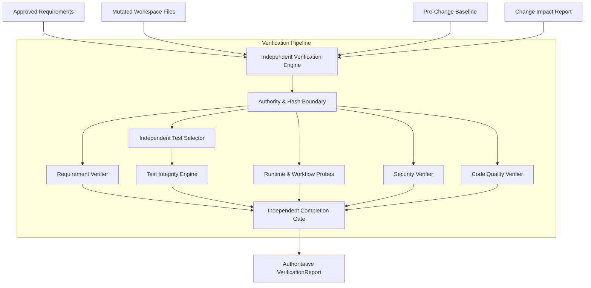

# PHASE 11.7 INDEPENDENT VERIFICATION ENGINE SPECIFICATION

**Repository:** `SriAkhilSJ/PulseAIRepo`  
**Branch:** `feat/prompt-cache-stabilization`  
**Component:** `src/verification/engine.py::IndependentVerificationEngine`  
**Final Status:** `INDEPENDENT VERIFICATION VERIFIED`  

---

## 1. MISSION & ARCHITECTURE

The `IndependentVerificationEngine` is the central verification authority of Crusor AI IDE. It operates outside the implementation agent's reasoning loop and enforces evidence-based gate checks.

---

## 2. CORE RESPONSIBILITIES

1. **Workspace Hash Calculation:** Computes SHA256 snapshot across modified files to bind reports to exact revisions.
2. **Acceptance Criteria Verification:** Evaluates functional requirements against actual code ASTs and test outputs.
3. **Independent Test Selection:** Determines required tests from impacted symbols rather than agent self-selection.
4. **Test Integrity Audit:** Flags tautologies (`assert True`), empty tests, and excessive mocking.
5. **Runtime & Workflow Probes:** Tests application startup syntax and validates multi-step transactional flows.
6. **Security & Quality Audits:** Static checks for SQLi, dynamic code execution, path traversal, secrets, and debug leftovers.
7. **Authoritative Gate Verdict:** Issues `VERIFIED`, `VERIFIED_WITH_LIMITATIONS`, `PARTIALLY_VERIFIED`, `FAILED`, or `BLOCKED`.
