# PHASE 11.8 PRODUCTION READINESS INTELLIGENCE ENGINE

**Repository:** `SriAkhilSJ/PulseAIRepo`  
**Subsystem:** `src/production/engine.py`  
**Verdict:** `PRODUCTION READINESS VERIFIED`  

---

## 1. CENTRAL ENGINE ARCHITECTURE

The `ProductionReadinessEngine` orchestrates 14 specialized readiness analyzers across all technical and operational disciplines:

```mermaid
graph TD
    PRE[ProductionReadinessEngine] --> PSA[Security Analyzer]
    PRE --> PCA[Configuration Analyzer]
    PRE --> SCA[Supply Chain Analyzer]
    PRE --> DAA[Deployment Analyzer]
    PRE --> CRA[CI/CD Analyzer]
    PRE --> DPA[Database Analyzer]
    PRE --> BRA[Backup & Recovery]
    PRE --> ORA[Observability Analyzer]
    PRE --> RRA[Reliability & Resilience]
    PRE --> PEA[Performance & Capacity]
    PRE --> ICA[Cost & FinOps Analyzer]
    PRE --> DRP[Rollback Planner]
    PRE --> IDA[Incident Playbook Gen]
    PRE --> PRA[Privacy & Compliance]
    PRE --> PRG[Authoritative Gate]
```

## 2. ATOMIC REPORT PERSISTENCE & DIGEST INTEGRITY
Every evaluation produces a persistent `ProductionReadinessReport` stored in `.crusorai/production_readiness/{task_id}_readiness_report.json`.
The report contains:
- SHA256 Evidence Digest computed over all dimension evaluations and findings.
- Explicit target environment profile.
- Immutable timestamp and source code revision hashes.
- Separation of verification status and deployment authorization flag (`deployment_authorized = False` by default).
