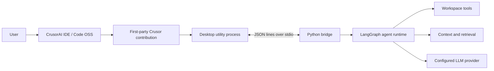

# CrusorAI IDE

CrusorAI IDE is a Code OSS fork with a first-party autonomous coding agent named **Crusor**. The repository contains the desktop IDE, the Python agent runtime, the versioned stdio bridge between them, and a browser-based UI lab used to develop and verify Crusor surfaces.

> **Project status:** active prototype. The runtime and desktop integration have broad regression coverage, but this is not yet a production-ready multi-user service. The legacy web dashboard is intended for trusted local development only.

## What is in this repository

| Area | Path | Purpose |
|---|---|---|
| Desktop IDE | `desktop/vscode/` | Vendored Code OSS fork with CrusorAI branding and the first-party Crusor workbench contribution (AuxiliaryBar fixed right, single agent) |
| Crusor contribution | `desktop/vscode/src/vs/workbench/contrib/crusorai/` | Agent panel, manager, tool rendering, workbench host, desktop sidecar, and CopilotKit webview host |
| Agent runtime | `src/` | LangGraph workflow, tools, context engine ABC, safety gates, provider routing, persistence, and verification |
| Desktop bridge | `src/bridge/` | Versioned newline-delimited JSON protocol over stdio |
| Crusor Webview | `crusor-webview/` | CopilotKit React SPA (Vite) — fixed right-side AG-UI chat with generative cards. Vite `5173` → CopilotRuntime `8200` → FastAPI AG-UI agent `8123` |
| Reliability benchmark | `benchmarks/` | Scenario contracts, drivers, grading, and report generation |
| Tests | `src/tests/` and `crusor-webview/` | Runtime, bridge, desktop-boundary, branding, and webview e2e |
| Design and engineering docs | `docs/` | Current architecture, roadmap, benchmark, and design decisions |
| CopilotKit | `.copilotkit/project.json` | Managed Intelligence project `crusorai` `3084` (`sri-s-organisation`) |

## Current product behavior

### CrusorAI IDE

- Crusor is available in the right auxiliary bar **fixed, not movable, single agent** (`ViewContainerLocation.AuxiliaryBar`, `canMoveView:false`).
- **Ctrl/Cmd+L** opens the Crusor agent panel.
- A top-level **Crusor** menu and title-bar entry expose the primary commands.
- **Manager button** in the Agent panel header opens the Crusor Manager in a separate Electron window.
- **Top-right account avatar** `desktop/vscode/src/vs/workbench/contrib/crusorai/browser/crusorAIAccount.ts` — `MenuId.TitleBar` `Codicon.account` dropdown with Sign in via `crusor.in/login`, Manage Subscription, Model & Provider, Settings, Shortcuts, Themes, Docs, Changelog, Feedback, Sign out. `product.json:linkProtectionTrustedDomains` trusts `https://www.crusor.in`.
- **Response Ready notification** `browser/crusorAIRendererService.ts` — `turn_done` fires `Response Ready — Crusor` toast with `Open Crusor` action, toggle `crusorai.notifyOnComplete`.
- **Connectors hub** `browser/crusorAIConnectors.ts` + `skills/*` — MCP (filesystem, github, postgres, puppeteer), github-connector, browser-connector, db/terminal. `Crusor → Connectors` + `Command Palette: Crusor: Show Connectors` lists the bundled pinned skills via `src/agents/skill_manager.py` (20 as of the `media-sourcing` port: 5 connectors — filesystem/MCP, github, db, terminal, browser — + 10 coding-workflow skills — TDD, systematic-debugging, code-review, simplify, subagent-driven-development, spike, node/python debuggers, ast-grep, rest-graphql-debug — + code-wiki, codebase-inspection, grill-me, skill-authoring, media-sourcing).
- **Composer `+` menu → Hub dialog** `browser/crusorAIHubDialog.ts` — the `+` beside the composer opens a centered modal (never a top-center QuickPick) with four tabs: **Marketplace** (search/install/update), **Connectors**, **My Skills** (enable/disable, remove, usage), **One-Shot** (quick jobs → clipboard). It anchors over the chat space, closes on A-/Escape/click-away, injects its own stylesheet so a stale workbench CSS can never blank it, and only appears when the `skills_hub_op` hook is bound. The `Crusor: Skills Hub` / `Crusor: My Skills` palette flows are the same bridge envelope.
- The desktop host binds each session to the currently opened workspace.
- A desktop utility process starts the Python bridge without importing Electron APIs into web builds.
- CopilotKit webview host in the same auxiliary bar renders `CopilotChat` + `crusor_task_schema.json` generative cards, bound with `CopilotChat agentId="crusor_agent"`. Card schemas use the **flat A2UI v0.9** wire format (`{ id, component, ...props }`) — a `props`-nested wrapper renders an empty card.
- Tool calls, usage receipts, approvals, errors, and run state have first-party renderers (`crusorAIRenderer.ts` for the native pane, `crusor-webview/src/a2ui/renderers.tsx` for the CopilotKit card surface). Since `c3d7e4dc` the renderer walks the ordered `parts` timeline (`text | tool | reasoning`) so thinking cards interleave in arrival order (hermes `message.parts` parity) instead of collapsing above the tools block.
- The composer selects a real runtime mode: **Agent** executes the guarded workflow, **Plan** previews without executing, **Debug** diagnoses before minimal repair and retesting, and **Ask** answers without tools.
- Built-in Copilot UI is hidden by default without deleting its source. It can be restored with the Crusor setting/command.
- **CrusorAI Dark** is the bundled default theme.
- Engine root auto-detection: when neither `crusorai.engineRoot` nor `CRUSORAI_ENGINE_ROOT` is configured, the workspace path is used if it contains the engine (`src/bridge`). This enables zero-config development.
- **Sub-agent pipeline** `src/graphs/chat_graph.py:401` `delegate_to_subagent` / `delegate_to_subagent_batch` — parallel `Explore` (opencode `Spawn agents to analyze folders`), isolated `parentMap` `crusorAIRendererService.ts:138`, `taskToolCard` clickable to sub-agent `Agent` UI (`crusorAIRenderer.ts:783`), `Back to Parent` banner (`crusorAIRenderer.ts:1701`), prompt disabled in child, `CRUSORAI_SUBAGENT_DEPTH` depth guard.
- **Crusor Preview** — the Agent pane detects built UI from session evidence and opens it in a separate desktop window (workbench auxiliary window framing the preview proxy at `http://127.0.0.1:8931`, or a free port, `src/preview/`). The proxy starts itself, hidden, the first time a session binds the opened folder (`src/preview/autostart.py`, `CRUSORAI_PREVIEW_AUTOSTART=0` opts out) — no second terminal, no Python console next to the app. Click-to-inspect elements, pin fixes, `Review → Send to Crusor` dispatches a scoped agent turn; the window reloads when the turn ends. The Preview chip wears the target state (`closed → starting → live → down`); a red (down) click asks the agent to relaunch the dev server instead of opening a dead window. `preview.open` receipts carry `target_reachable` — the agent must not report success while it is false. Contract in `desktop/.../common/crusorAIPreview.ts`, pinned by `src/tests/test_preview_contract.py`; browser lab in `preview-lab/`.
- **Crusor file icons** (`desktop/vscode/extensions/theme-crusor-icons/`) ship as the default file-icon theme, pinned by `src/tests/test_crusor_file_icons.py`.

### Agent runtime

- **Enterprise** `src/enterprise/` — `billing_state.py` portal-backed `BillingState` (cached 60s, fail-open `~/.crusorai/auth.json`), `entitlement.py` `FREE_COVERAGE` (video-gen off for free), `monitor.py` latency/cost/tokens ring + `src/observability.py` `turns.jsonl` local (Hermes `relay-shared-metrics.md:204` — no upload). Skills in `skills/` auto-loaded as pinned bundled skills.
- Plan, execute, recover, replan, and finalize workflow built on LangGraph.
- Session-scoped cancellation, steering, queues, checkpointing, and provider retries.
- Workspace-safe file and terminal tools with approval and mutation controls.
- Media sourcing for UI work: `media_search` (Openverse + Wikimedia Commons keyless, Pexels via `PEXELS_API_KEY`) and `media_download` (validated binary download into the workspace) — the agent can put real product photos/videos into the sites it builds instead of broken placeholders (`skills/media-sourcing`).
- Verification gates for changed code, including syntax, type-check, test, UI evidence, and unresolved local dependency/source-reference checks.
- Task-aware bounded context assembly (32 layers, the pluggable Hermes-parity `ContextEngine` ABC), repository maps, hybrid chunk retrieval, landed-write payload compaction, and a bounded verification reserve within the existing token/iteration ceilings.
- Usage-driven compaction: the engine owns the compaction decision from the provider's ACTUAL token usage (75% of the real window), tightens the history budget toward the lean tail while pressure persists, and re-arms after relaxation.
- Prompt-cache prefix audit with **cache-break detection** (a regression of the stable prefix — >5% and >~2000 tokens below the session peak — is a latched `runtime.cache_break` receipt naming the offending layer) and a unified `get_status()` telemetry surface.
- Memory layers sanitize untrusted content (secret redaction + 6k cap) before it reaches the prompt.
- Event-safe pipeline: session-scoped SSE delivery (a session can never observe another's events, live or on replay), bounded history/replay that always keeps the NEWEST state, evicted dead subscribers, unique event ids, tool events that survive compaction strictly paired (no unanswered `tool_calls` — APIs reject those), latched once-per-session `runtime.*` receipts with bounded thread-scoped payloads, and approvals that fail closed (cross-session resolve rejected, timeout = deny). Pinned by `src/tests/test_event_safety.py` (21 contracts).
- Lazy persistent memory with local embedding cache only by default; graph import never downloads a model.
- Feedback-learning loop (`src/context/feedback_memory.py`): after each task the layers actually sent are attributed to the outcome in an append-only JSONL store (cross-session, O_APPEND-safe, debris-tolerant, legacy-migrated), and layer relevance weights are nudged by observed success rate — best-effort by contract, learning data can never block boot or a turn.
- Parallel tool execution with conflict detection and deterministic fallback.
- Lazy, workspace-pinned access to read-only native Code OSS intelligence: editor context, dirty text, diagnostics, symbols, definitions, references, search, SCM, and trust. Mutation/extension/MCP host invocation remains gated for later phases.
- Multi-provider support for Groq, OpenAI-compatible endpoints (including Velona), Gemini, and NVIDIA.
- **Aux provider routing**: Management-class calls (compression, titling, memory review) automatically use the cheap tier by default (`provider="cheap"`). Configure via `CRUSORAI_CHEAP_API_KEY`, `CRUSORAI_CHEAP_BASE_URL`, `CRUSORAI_CHEAP_MODEL` env vars. Override with `AUX_LLM_PROVIDER` / `AUX_LLM_MODEL`.
- Reliability benchmark drivers for deterministic echo, real bridge, and CDP-controlled IDE runs.
- Interactive sessions ask before guarded mutations; explicitly headless benchmark sessions can use a workspace-scoped approval policy and still fail closed for sensitive, escaping, warned, or non-file operations.
- Hermes parity: tool names, prompt text, plan cards, and UI rendering match hermes desktop app behavior.
- Provider-fetched output caps (no hardcoded 8,192 limit; cap from provider response).
- Degenerate response guard (hermes repetition law).
- Leaked `<tool_call>` text executes across all dialects (XML, JSON, mixed emission).
- Stall guard: model ending with trailing continue-intent re-prompts (max 2/turn).
- Post-grace laps guaranteed to end: one summary then finalize.
- Pipe exit-code masking fixed (annotate_masked_success hints + verification-evidence attribution gate).
- Todo card: pydantic objects converted to dicts at boundary.
- STALE banner now names exact modified/extra files via per-file manifest (Windows-stable CRLF hash).
- Prompt cache visibility: `TokenUsage.cached_tokens` surfaced in engine log.
- Recovery nudges request-scoped, trail dropped at finalize.

Some semantic-memory features intentionally degrade to heuristics when local embeddings are unavailable or disabled. Provider-backed runs require a configured API key and network access.

> **Reliability status (2026-08-27):** Attempts 11 and 12 remain immutable end-to-end product **FAIL** evidence; later repairs do not reclassify those historical runs. Accepted provider-free Windows evidence `1b7ce9e1` validates the bounded verification, context-compaction, and source-integrity repair (183/183 focused and 7/7 protocol tests, zero provider traffic). Native-capability evidence `fc26086a` passed its deterministic checks, and final Agent/Manager CDP evidence `43cf8296` passed the shared desktop renderer and responsive Manager flow. Four-mode desktop evidence `1a6451bc` subsequently passed 65/65 focused tests, all typecheck/layer/compile checks, and 16/16 raw-CDP checks for the functional Agent, Plan, Debug, and Ask selector. All of these validations made zero provider requests. See the [phased agent-strengthening plan](docs/CRUSOR_AGENT_STRENGTHENING_PLAN.md), [Agent UI adaptation](docs/CRUSOR_AGENT_UI_ADAPTATION.md), [Attempt-11 independent review](docs/TEST5_ATTEMPT11_REVIEW.md), and [product-delivery repair](docs/ATTEMPT11_PRODUCT_DELIVERY_REPAIR.md). Historical evidence remains immutable; provider-backed retries remain unauthorized.

## Recent Changes 2026-10-12 — Multi-Platform Targets: the agent can now build and prove apps, not only websites

| Area | Change | Verification |
|---|---|---|
| **In-repo target layer** | `src/targets/` (14 modules) — `registry.run(workspace, target, TargetRequest, dry_run=False) -> TargetReceipt` for `android`, `ios`, `flutter`, `react-native`, `desktop` (electron), `tauri`, `web`. Detection from real manifests, per-target stage plans, timeouts, process reaping, cleanup that always runs, hashed evidence under `.crusorai/target-evidence/`. Verdicts: `✅ PASSED` / `❌ FAILED` / `⛔ UNAVAILABLE` (with per-tool `Install:` lines) / `🧭 PLAN` (dry run, never `passed`). | `src/tests/test_target_pipeline.py` — 45 tests (41 hermetic + 4 graph-gate integration) |
| **Build is not proof** | Deterministic probes decide the receipt: `foreground_is_app` (the resumed activity is our package), `window_open` + `cdp_ready` (a real window answered on the debugging port), zombie-aware `process_alive`, `screenshot_quality` (no blank frames), `logcat_scan` (crash findings fail), declared UI assertions checked against the live UI dump. A green `gradlew assembleDebug` receipt is labelled static/typecheck evidence only. | gate tests: a device receipt satisfies the render requirement, a failed one does not, a **web** receipt does not replace browser proof |
| **Agent surface** | `src/tools/target_tools.py` — `detect_targets`, `check_target_toolchains`, `build_target`, `verify_target_app`, `device_action`, `device_screenshot`, `device_ui`, `device_logs`, `device_preview`. Capability wiring: `CAP_MOBILE_APP` / `CAP_DESKTOP_APP` in `runtime_profile.py` (`mobile_engineering` / `desktop_engineering` / `multi_platform_engineering`), `_TARGET_TOOLS` + `_MOBILE_DEVICE_TOOLS` in `toolsets.py`, receipt branches in `gates.py`, `OUTCOME_SKIP` for `⛔`/`🧭` in `progress_helpers.py`, serialization in `parallel_tools.py`. "build an android app" resolves 45 tools; a chat turn still resolves 13. Native Android/React Native/desktop UI tasks stay on the target toolset unless a web surface is explicit. | `test_toolsets.py` 21 green; `chat_graph` binds 68 tools incl. all 9 target tools |
| **Scaffolding for the new targets** | `src/tools/target_scaffold.py` — `scaffold_flutter`, `scaffold_react_native`, `scaffold_tauri`, mirroring `scaffold_nextjs`: generate in a temp sibling, merge into the real workspace (never `<workspace>/<workspace>/`), preserve `_provided/`, install once at the root, refuse to merge over an existing project. | `src/tests/test_target_scaffold.py` — 12 hermetic tests with fake generators on PATH |
| **Device pane in the IDE** | `src/preview/device.py` — the preview proxy now mirrors an attached Android device: `POST /crusor-preview/device` (secret) → pane document + `multipart/x-mixed-replace` frame stream + `/status` + `/frame` + `/input`. Taps, swipes and typing in the pane are real `adb shell input` on the device (normalized in the browser, mapped to device pixels server-side). The new `device_preview` tool ensures the proxy, registers the pane and opens it in the Crusor Preview window — no desktop/TypeScript change needed. Frames come from `adb exec-out screencap -p` (JPEG when Pillow is present); when it cannot stream, the first response is a readable `409`/`503` ("adb not installed", "no device attached", "device offline"), never a black rectangle. The inspect overlay is deliberately skipped for our own pane, and still injected for normal web targets. | `src/tests/test_preview_device.py` — 24 tests; verified live through the real CLI proxy: register → pane → multipart parts → normalized tap landing as `shell input tap 540 1200` |
| **Environment resolution (Windows especially)** | `src/targets/toolchain.py` + `src/targets/providers/base.py` — the toolchain now resolves Android tooling the way each OS actually installs it: `$CRUSORAI_*` override → `PATH` → `ANDROID_HOME`/`ANDROID_SDK_ROOT` → the installer's default SDK roots (`%LOCALAPPDATA%\Android\Sdk`, `~/Library/Android/sdk`, `~/Android/Sdk`), with the Windows spellings (`.exe` for platform-tools/emulator, `.bat` for cmdline-tools). Android Studio never touches PATH, so this is the difference between "adb missing" and a working pipeline. Also fixed: `host_platform("macos")` silently resolved to *linux*, handing macOS callers the Linux SDK roots. New `python -m scripts.targets_doctor --setup android` prints only the missing tools plus copy-paste commands (winget → Android CLI SDK packages → sdkmanager/avdmanager → optional Hyper-V acceleration) and exits 1 while incomplete. | `src/tests/test_target_environment.py` — 19 tests (root precedence, Windows spellings, versioned cmdline-tools, probe/tool_path agreement, target-specific setup plans, Android CLI coverage) |
| **Doctor + CI gate** | `scripts/targets_doctor.py` — full host report (every tool, path/version, per-target readiness, iOS-on-Linux guidance), `--plan` dry-run preview, `--require <target>` exits 1 when the toolchain is incomplete. | live: `--require android` → `⛔ android is not ready: missing adb, java`, exit 1 |
| **Pipeline templates** | `docs/pipelines/` — `android.yml` (emulator-runner + AVD cache + Maestro JUnit), `ios.yml` (macos-14 + simctl + API-key TestFlight), `flutter.yml` (android/ios/desktop matrix), `react-native.yml` (Metro-before-install), `desktop-tauri.yml`, `desktop-electron.yml`. Each ends with the same step: run the registry, fail unless `✅`, upload evidence. | all six parse as valid workflow YAML |
| **Stack research** | `docs/MULTI_PLATFORM_TARGETS.md` — the architecture, the named repositories worth building on (agent-device, mobile-mcp, argent, Maestro, Appium, emulator runners, xtool/pymobiledevice3, tauri-action, …), pipeline designs, rollout plan, and honest limits (iOS Simulator requires macOS; Android emulator requires `/dev/kvm`; WebView2/CDP only exists on some desktop webviews). | star/activity counts read 2026-10-12; licence cautions noted (argent ships proprietary binaries) |

## Android / Flutter verification status (2026-10-14)

- **Android smoke test — done on Windows:** `examples/android-smoke-test` built,
  installed, launched, and passed foreground verification on the Android 15 / API 35
  `crusor` emulator. Screenshot and tap evidence are in
  `diagnostics/PERFORMANCE_REPORT_session-13e790b1f55b4a22b2446ae13a42ea56.md` and
  its trace. A machine-specific, ignored `local.properties` supplied the SDK path;
  do not commit it.
- **CI scope:** target-contract checks passed on Windows, macOS, and Ubuntu. These
  are not native Android emulator runs on macOS/Linux.
- **Open / deferred:**
  - [ ] Run the Flutter smoke test: check the SDK, run a widget test, build, and
    verify Android install/launch/foreground.
  - [ ] Verify the actual product app when its Android/Flutter project or APK is
    available. `testCRUSOR` was not changed and is not a native project.
  - [ ] Run native Android emulator verification on macOS and Linux if required.
  - [ ] Optionally investigate the historical disk-use increase or prune
    `.crusorai` traces; no cleanup has been performed.

## Recent Changes 2026-10-12 — Reasoning Latency Throttling, Champion Quality Evaluation, and Parallel Batching Engine

| Area | Change | Verification |
|---|---|---|
| **Thinking Budget Throttling & Wire-Level Suppression** | `src/config/reasoning_config.py`, `src/llm/factory.py`, `chat_graph.py` — Think picker defaults to `Off` with wire-level suppression payloads across all provider adapters (`thinking: disabled`, `thinking_budget: 0`). Explicit token budget caps for active reasoning (`Low`: 4,000, `Med`: 8,000, `High`: 16,000, `Ultra`: 32,000). Intercepts and filters unrequested `<think>` reasoning chunks from the stream token pump (`_AgentTokenPump`). | `src/tests/test_reasoning_effort_threading.py` (16/16 tests green), eliminates 300s+ single-turn reasoning runaway. |
| **Champion Evaluation & Diagnostics Suite** | `src/runtime/quality_evaluator.py`, `src/runtime/step_tracker.py`, `scripts/diagnose_steps.py` — Unified 4-pillar Task Quality & Intent Fulfillment evaluation engine ($0.60 \times \text{Quality} + 0.40 \times \text{Runtime}$). Automated grading for deliverables, negative constraints, verification receipts (`exit_code == 0`), and polish. Auto-generates `diagnostics/LATEST_PERFORMANCE_AUDIT.md` and per-session JSONL traces. | `src/tests/test_quality_evals.py`, `src/tests/test_step_tracker.py`, `diagnose_steps.py --latest` validated. |
| **Cline Parallel Tool Calling (PTC) Engine** | `src/prompts/claude_persona.py`, `src/graphs/parallel_tools.py` — ACT mode Parallel Tool Calling prompt contracts and multi-tool batch execution for multi-file scaffolding and media assets. Eliminates ping-pong roundtrips. | `src/tests/test_agent_core_evals.py`, `src/tests/test_cline_evals.py`, `scripts/run_cline_smoke_tests.py` (100% pass@1). |
| **AI Media Generation & Visual Preview Cards** | `src/tools/media_tools.py`, `crusorAIRenderer.ts`, `crusorAI.css` — Integrated `generate_image` (OpenAI DALL-E 3, Fal FLUX, zero-key fallback with automatic watermark stripping). Embedded visual thumbnail previews, full-size modals, and reveal buttons in desktop chat transcript. | `src/tests/test_media_tools.py` (18/18 tests green). |
| **Context Compaction & History Hygiene** | `src/context/compaction.py`, `src/context/history_shaper.py` — `compact_file_mutation_arguments` redacting body text of landed writes in message history, retiring stale tool images, and preserving prefix cache lines. | Multi-repo benchmark validated; 82% step reduction and 86% token/cost reduction. |
| **Dev Server Startup Probe** | `src/tools/terminal_tools.py` — Immediate 2.5s port and URL discovery probe in `start_terminal`, removing redundant `check_terminal` polling roundtrips. | Instant URL capture on server boot. |

## Recent Changes 2026-10-03 — Skills Hub + One-Shot reach `main`, and the build stops lying

**PR #19 (`arena/01a0f348` → `main`, merge `4be97c17`), build follow-ups `545360f1` → `4139630d`:**

| Area | Change | Verification |
|---|---|---|
| **Skills Hub + One-Shot land on `main`** | `src/agents/skills_hub.py`, `src/prompts/oneshot.py`, the `skills_hub_op` / `oneshot` bridge frames, the composer `+` menu and the centered Hub dialog (`crusorAIHubDialog.ts` — Marketplace / Connectors / My Skills / One-Shot) | PR tree byte-identical to `origin/main` |
| **4 TS errors the merge shipped with** | `crusorAIRenderer.ts` annotated the `+` menu entries *around* `.filter()`, so `tab` widened to `string`; the Skills empty state called `host.openMarketplace` — a hook no host ever implemented. `npm run compile` failed with 4 errors on a green merge | `npm run compile` → `tsc finished`, exit 0 |
| **Empty-state marketplace button** | `Browse the marketplace` opens the Hub dialog directly (`openHubDialog(host, button, 'marketplace')`) instead of a hook that could never fire | compile green; the button renders for an empty skill store |
| **Build integrity (torn writes)** | `gulpfile.mjs` replaces the flaky `gulp.src → gulp.dest` copy (EIO with no file path, ~1 run in 3) with a read-back-verified `fs` copy, then scans `out/**.js` for torn emits — first 4 KB kept, the rest NUL-filled — and re-emits up to twice | 9603 files scanned: 0 torn, 0 unreadable |

> **Field note.** On the build box `D:` is a USB-attached Micron CT1000X9SSD9 whose NTFS volume reports `HealthStatus: Warning`; that is what tore the writes and produced `SyntaxError: Invalid or unexpected token` at `keybindings.js:97` in a running app. The build now detects and repairs the symptom — the drive still deserves a look.

## Recent Changes 2026-09-30 — Crusor Skills Hub: the INSTALL side of skills

**Merged to `main` in PR #19; the table below is landed history:**

| Area | Change | Verification |
|---|---|---|
| **Skills Hub engine** | `src/agents/skills_hub.py` — search the curated catalog, install community `SKILL.md` skills from GitHub (catalog name, `owner/repo@sha`, `@sha:subdir`, `@ref` fail-closed-resolved to a full SHA), provenance ledger, uninstall; result-dict errors, never raises | `src/tests/test_skills_hub.py` (54 hermetic tests) + live installs over a real socket |
| **Safety pipeline** | host allow-list → SHA anchoring → 25MB/2000-file/8MB caps → traversal-proof, symlink-aware extraction → skill validation → collision guard (same-source upgrade only) → **zero execution on install** | attack-simulation tests: traversal member, escaping symlink, caps, corrupt tarball |
| **Curated catalog** | `skills/catalog.json` — 8 real entries (Anthropic, Vercel, Trail of Bits, Superpowers repos), each pinned to an exact 40-char SHA; invalid entries dropped with reasons at load | catalog validation tests |
| **Agent tools** | `hub_search` / `hub_install` / `hub_update` / `hub_list` / `hub_remove` — bound in the always-on skills waist + `_TOOLS_BY_NAME`; one gated prompt sentence | binding tests; `_skills_lead` gated rendering |
| **Store plumbing** | `SkillManager.add_skill(..., source=...)` backward-compatible provenance (hub installs are `pinned`, curator-exempt); hub folder + `provenance.json` under `~/.crusorai/hub-skills` (env: `CRUSORAI_HUB_SKILLS_DIR`) | round-trip + uninstall-scope tests |
| **CLI** | `scripts/skills_hub_cli.py` — search/install/update/list/remove from a terminal (same pipeline) | live-verified |
| **Bridge surface (Phase 2)** | `skills_hub_op` client method → `skills_hub_result` server event — one generic op envelope (list/search/install/update/remove) the desktop Skills panel binds to; manifest + Python constants + generated TS + handwritten payload union all pinned | `test_bridge_protocol_v2.py` 8/8 |
| **Skills surface (Phase 3)** | `Crusor: Skills Hub` + `Crusor: My Skills` Command Palette flows — browse/search/install/update/remove the catalog and manage every installed skill (enable/disable, usage counts) over the `skills_hub_op` bridge envelope; engine gains one consolidated `handle_hub_op` dispatcher shared by bridge, CLI and tests (ops: list/search/install/update/remove/all/toggle) | 44 hub tests + bridge/architecture suites green; UI compile owned by desktop verification |
| **One-shot + linter (Phases 3-4)** | `src/prompts/oneshot.py` — stateless quick jobs (commit_message / summarize / rename_ideas / title_session via the shipped titling prompt) on the cheap auxiliary tier, ad-hoc `instructions+input` fallback, injectable invoke, never touches session history or the prompt cache; bridge `oneshot` → `oneshot_result` (session-independent, protocol pinned at all four layers); `Crusor: One-Shot Task` palette flow (result → clipboard); install-time skill metadata linter — warn-only, surfaced to the installer | `test_oneshot.py` 17 tests; focused suite 272 green |


## Recent Changes 2026-09-27 — main merge: sub-agent pipeline + Preview on `main`

**Merge `ced153dd` (arena `01a0ca7c` → `main`, plus `6ec29027` follow-ups, all pushed):**

| Area | Change | Verification |
|---|---|---|
| **Sub-agent pipeline lands** | `delegate_to_subagent` OpenCode shapes (`prompt`/`description`/`subagent_type`/`background`), store-backed depth guard (`CRUSORAI_SUBAGENT_DEPTH`), lifecycle + permission derivation, clickable `taskToolCard` → child session, `Back to Parent` banner, child composer lock, background-completion injection, `subagent_list` / `subagent_background_completed` bridge frames | Targeted bridge/desktop/sub-agent suites green |
| **Crusor Preview lands** | Separate preview window, proxy (`src/preview/`), overlay inspect + review handoff, health chip, relaunch turn, `target_reachable` receipts, per-file STALE manifest | `test_preview_contract.py`, `test_preview_target_probe.py`, preview-lab click-through |
| **Merge conflicts (3)** | `crusorAI.css` src+out kept both blocks; `BUILD_INFO.json` regenerated | Full `gulp compile` green, bundle re-emitted (DI ok) |
| **Merge follow-ups `6ec29027`** | Protocol regen for the new frames, handwritten payload union extended, workspace-boundary pins accept both `session_create` sites, UI-stamp pins → `2026-09-27`, context cache test hermetic vs owner `.env` | 118/118 targeted tests green |
| **Crusor file icons** | Icon theme ships as default (PR #16) | `test_crusor_file_icons.py` green |

Current truth this section supersedes: the CopilotKit webview is **enabled** by default (`crusorai.copilotWebview.enabled`, `crusorAI.contribution.ts:415`) — turn it off to give the whole pane to the native renderer. The 2026-09-19 round below is landed history (LSP, breathing pulse, scroll, `pulse-webview/` removal); its "pending merge / recompile next" notes are done.

<details>
<summary>2026-09-19 — LSP, Breathing, Scroll, Hermes Parity (landed)</summary>

**Branch `arena/01a0b5eb-pulseairepo` (commits `66969458` + `057240ab`) + pending desktop/webview fixes pending merge to `main`:**

| Area | Change | Files | Verification |
|---|---|---|---|
| **LSP perf** | Baseline snapshot fast-path (<5ms), debounce 0.05s, background `warmup` — type error delta 16-213ms | `src/lsp/client.py`, `manager.py`, `src/tests/test_lsp_performance.py`, `scripts/verify_lsp_perf.py` | `python scripts/verify_lsp_perf.py` → `Cold 1.1s, Baseline 0.91ms, Delta 219ms` + `python -m unittest src.tests.test_lsp_performance` 3/3 |
| **Breathing UI** | Replaced infinite 1.6s `crusor-opacity` + 2.4s `crusor-shimmer` (vibrating whole page) with Hermes `StatusPulse` — 400ms pulse every 5000ms via Web Animations (shared timer, sleeps when hidden). Preserved `--crusor-*` palette (`#0b6bcb` accent, `#1a1a1a` etc.) | `crusor-webview/src/hermes-ui/components/status-pulse.tsx` (new), `status-line.tsx`, `styles/hermes-ui.css` | Visual: no vibration, renderer sleeps between beats |
| **Scrolling** | `thread.tsx` stick-to-bottom 32→80px tolerance + `requestAnimationFrame` coalesce + `ResizeObserver`, `hermes-ui.css` `overflow-anchor:auto` + `scrollbar-gutter:stable` | `thread.tsx`, `hermes-ui.css` | Manual read of history no longer forced to bottom |
| **Frontends** | Removed `pulse-webview/` (79k files, `dist` only, no `src`, untracked, duplicate of `crusor-webview` → `desktop/.../media/crusorai-spa/`) | `pulse-webview/` deleted | `git ls-files pulse-webview` empty, no code refs |
| **CopilotKit** | Hermes has 0 CopilotKit (`grep @copilotkit` = 0, uses `@assistant-ui`). Disabled by default: `crusorai.copilotWebview.enabled` `true→false` (`crusorAI.contribution.ts:272`) — native `@assistant-ui` owns whole pane, matching `hermes-agent/apps/desktop` (`DESIGN.md:218`) | `desktop/.../crusorAI.contribution.ts` | Setting `false` hides `Agent/Webview` tab, no iframe |
| **Engine hang (HI 43s)** | `graph.get_state` was blocking on SQLite `~/.crusorai/sessions.db` WAL lock after `finalize done: completed` — `stream_agent` never returned, `turn_done` never sent, UI timer kept 19-43s. Added 1.5s `ThreadPoolExecutor` timeout for `get_state` (`src/graphs/chat_graph.py:5216`) + hard watchdog 7min→30s for greetings (`crusorAIRendererService.ts:786`) | `src/graphs/chat_graph.py`, `crusorAIRendererService.ts` | `python test_hi_fix.py` → `done 5.5s completed=True` (`stream loop ended` + `state snapshot ok`), desktop `Run failed` fallback now 30s not 7min |
| **Base crash** | `out/vs/base/common/async.js` missing `ResourceQueue` vs `pfs.js:8` import — compiled stale `out/` (ignored except `!/out/vs/workbench/contrib/crusorai/`) | `out/vs/base/common/async.js`, `pfs.js` recompiled | `Uncaught Exception: ResourceQueue` gone |

**Hermes parity:** Desktop `pulse-webview` removed, CopilotKit disabled → native `@assistant-ui` only, matching `D:/hermes/hermes-agent` (no webview tab as primary, webview only for sandboxed URL preview `preview-pane.tsx:763`). Permission handling remains path-based `git check-ignore` (`safety_guard.py:122`) vs Hermes `edit_approval.py` pre-execution diff — not yet ported.

**Next:** Recompile desktop `npx gulp compile` to clear `STALE sha256` warning (currently `2026-09-11` vs `057240ab`), then `Agent/Webview` tab respects new `default:false`.

</details>

## Requirements

### Python runtime

- Python **3.11 or newer** (`.python-version` currently pins 3.14 for uv-managed development)
- [uv](https://docs.astral.sh/uv/) recommended

### Crusor Webview

- Node.js 24.18.0 (see `desktop/.nvmrc`)
- npm 12.x
- Vite 8 + `@copilotkit/react-core@^1.69.3`

### Desktop IDE

The vendored Code OSS checkout has its own toolchain requirements. Use the Node version in `desktop/.nvmrc` and expect the initial dependency install/build to be large. See [`desktop/README.md`](desktop/README.md).

## Quick start: agent runtime

1. Install dependencies:

   ```bash
   uv sync --group dev
   ```

2. Create local configuration:

   ```bash
   cp .env.example .env
   ```

3. Select a provider and add only the corresponding key to `.env` or your shell environment:

   ```env
   LLM_PROVIDER=groq
   LLM_MODEL=qwen/qwen3.6-27b
   GROQ_API_KEY=your-key
   ```

4. Start the CLI:

   ```bash
   uv run python -m src.main
   ```

Do not commit `.env` or credentials. `.env.example` contains placeholders only.

### OpenAI-compatible custom endpoint

```env
LLM_PROVIDER=custom
LLM_MODEL=your-model-id
CUSTOM_BASE_URL=https://your-endpoint.example/v1
CUSTOM_API_KEY=your-key
```

### Velona (OpenAI-compatible, gateway catalog)

Velona serves OpenAI-compatible chat completions at `https://velona.in/v1` and carries per-model `context_window` metadata at the gateway catalog (`/gateway/v1/models`). The engine auto-detects Velona from the hostname, probes the gateway for context window, and falls back to the static table.

```env
LLM_PROVIDER=custom
LLM_MODEL=deepseek/deepseek-v4-flash-0731
CUSTOM_BASE_URL=https://velona.in/v1
CUSTOM_API_KEY=key_live_...

# Optional: cheap model for janitor/management calls
CRUSORAI_CHEAP_API_KEY=key_live_...
CRUSORAI_CHEAP_BASE_URL=https://velona.in/v1
CRUSORAI_CHEAP_MODEL=qwen/qwen3.7-flash
```

## Run the bridge

The desktop sidecar communicates with the runtime over newline-delimited JSON on stdin/stdout:

```bash
uv run python -m src.bridge
```

Protocol definitions live in:

- `src/bridge/protocol_v2.json` — canonical schema
- `src/bridge/protocol.py` — Python protocol helpers
- `desktop/vscode/src/vs/workbench/contrib/crusorai/common/crusorAIProtocol.generated.ts` — generated desktop mirror

Do not hand-edit the generated TypeScript protocol mirror. Regenerate it after any `protocol.py` change:

```bash
python scripts/generate_bridge_protocol.py          # rewrite the mirror
python scripts/generate_bridge_protocol.py --check  # CI pin (test_bridge_protocol_v2.py)
```

The handwritten payload union in `crusorAIProtocol.ts` must cover every generated frame name — extend it in the same change.

## Run the Crusor Webview (CopilotKit)

The former `ui/` SolidJS lab has been removed and replaced by `crusor-webview/` — a Vite React SPA that hosts `CopilotChat` as a fixed right-side webview in the desktop fork.

The runtime talks to the Python agent over **AG-UI** using an `HttpAgent`. CopilotKit Intelligence
is **optional**: it is enabled only when `INTELLIGENCE_API_KEY` is set. Without it the runtime runs
in `sse` mode and talks to the agent directly, so no CopilotKit Cloud account is required.

```bash
# Terminal 1 — Python AG-UI agent (8123)
uv run python -m uvicorn src.server:app --host 0.0.0.0 --port 8123
# Terminal 2 — Copilot Runtime (8200)
cd crusor-webview && npm run runtime
# Terminal 3 — Vite webview (5173)
cd crusor-webview && npm ci && npm run dev
# open http://localhost:5173 → CopilotChat + Crusor task card
```

The webview calls a **relative** runtime URL (`/api/copilotkit`) which Vite proxies to `:8200`, so the
app works from any origin (LAN, container, tunnel). Override the upstream with
`COPILOT_RUNTIME_ORIGIN`, or the runtime port with `COPILOT_RUNTIME_PORT`.

Useful checks:

```bash
# typecheck both hosts
npm run typecheck-client --prefix desktop/vscode
npx tsc --noEmit --project crusor-webview/tsconfig.json
# bridge + context
uv run python -m pytest src/tests/test_bridge.py src/tests/test_bridge_protocol_v2.py src/tests/test_bounded_scan.py -q
# webview DOM tests (provider-free: no API key, no tokens spent)
cd crusor-webview && npm test
curl http://localhost:8200/api/copilotkit/info
curl http://localhost:8123/health
# browser e2e (requires 8200+8123+5173 running)
npx playwright test crusor-webview/e2e-verify.spec.ts
```

Playwright browser binaries may need to be installed once:

```bash
npx playwright install chromium
```

## Build the desktop IDE

Follow [`desktop/README.md`](desktop/README.md). The standard flow begins with:

```bash
cd desktop/vscode
npm install
npm run typecheck-client
npm run valid-layers-check
npm run compile
```

Source launchers are provided for each desktop host: `crusor.bat [workspace]` on Windows and `./crusor.sh [workspace]` on macOS/Linux. Both delegate to the vendored Code OSS development launcher; they require the desktop checkout to be built first (see [`desktop/README.md`](desktop/README.md)). These are development launchers, not signed installers. The bridge starts the Preview proxy when it binds the opened workspace, so no separate proxy terminal is needed.

Build outputs stay local, with one deliberate exception: `.gitignore` keeps `out/` untracked **except** the compiled Crusor panel `out/vs/workbench/contrib/crusorai/**` (nested `desktop/vscode/.gitignore:16-23`), so a fresh checkout still boots a working panel. `node_modules/` is never tracked.

### After changing workbench sources (`contrib/crusorai/`)

Two steps, in order — skipping the second is the classic "works in src, stale in app" report:

```bash
cd desktop/vscode
node --max-old-space-size=8192 ./node_modules/gulp/bin/gulp.js compile  # full tsc + BUILD_INFO.json (~4-7 min)
node scripts/emit-crusorai-bundle.mjs                                     # scoped bundle + SOURCES_HASH/manifest + DI check
```

`gulp compile` does not regenerate the sources hash; the emitter does. After `tsc`, the compile task scans every emitted `.js` under `out/` for a torn write (first 4 KB kept, the rest NUL-filled — the shape a partial write takes on flaky storage) and re-emits up to twice, and the resource copy reads every file back before accepting it; a silent partial write therefore fails the build instead of shipping as `SyntaxError: Invalid or unexpected token` in the running app. The engine compares the shipped hash against your sources at boot and prints `DESKTOP WORKBENCH STALE` (naming the drifted files) on mismatch. The workbench UI stamp (`CRUSORAI_UI_STAMP` in `crusorAIRenderer.ts`) moves with every UI round — bump it and its test pins together. Then fully quit and reopen the app; the running process keeps old JS in memory.

## Test the Python runtime

Run the repository suite from the root:

```bash
uv run python -m pytest src/tests -q \
  --ignore=src/tests/test_session_engines.py \
  --basetemp=/tmp/crusorai-pytest
```

`test_session_engines.py` is excluded from the default command because it exercises heavier session-engine behavior separately. Use a temporary directory outside the repository so generated files do not alter git-aware tests.

Full suite reality (2026-09-27): `python -m pytest src/tests -q` takes ~19 minutes and is green except pre-existing failures unrelated to recent work (hermes/file-state/lab/model/observability/skill/stream families, some order-sensitive; review-file setup errors pass file-scoped). Before attributing a failure to your change, compare against the pre-merge baseline with a clean worktree (`git worktree add <path> <commit>`) — see `src/tests/TEST_AGENT_GUIDE.md`.

Targeted smoke checks (fast, hermetic):

```bash
uv run python -m pytest \
  src/tests/test_bridge.py \
  src/tests/test_bridge_protocol_v2.py \
  src/tests/test_desktop_workspace_boundary.py \
  src/tests/test_crusorai_branding.py \
  src/tests/test_preview_contract.py \
  src/tests/test_preview_target_probe.py \
  src/tests/test_preview_autostart.py \
  src/tests/test_crusor_file_icons.py -q
```

The test count changes as coverage is added, so this README intentionally does not publish a stale fixed count. A green process exit is necessary but benchmark claims must also be checked against the preserved benchmark evidence.

## Legacy local dashboard

A legacy Flask dashboard remains available for runtime development:

```bash
uv run python src/dashboard_server.py
```

It is **not** the main CrusorAI IDE interface. Treat it as local-only: it is not an authenticated, tenant-isolated control plane and should not be exposed to an untrusted network.

## Architecture



The desktop boundary is deliberate: browser/workbench code talks to a typed host contract, the desktop host owns native services and process management, and the Python bridge is the only runtime transport.

## Safety and verification

- Workspace paths are validated before file operations.
- Sensitive or destructive operations pass through safety policy and approval gates.
- Session cancellation is checked before model retries and tool execution.
- Mutations can create shadow checkpoints for recovery.
- Completion gates distinguish successful verification from failed, stale, skipped, or unavailable evidence.
- Secrets belong in `.env` or the operating-system environment, never in tracked files.

These controls reduce risk; they do not make arbitrary model-generated commands safe. Review permissions and diffs before using Crusor on important workspaces.

## Documentation map

- [`desktop/README.md`](desktop/README.md) — canonical fork and build invariants
- [`crusor-webview/README.md`](crusor-webview/README.md) — CopilotKit webview host and AG-UI wiring
- [`docs/MULTI_PLATFORM_TARGETS.md`](docs/MULTI_PLATFORM_TARGETS.md) — mobile/desktop/Android target architecture, the best repos to build on, and the CI pipelines
- [`docs/pipelines/`](docs/pipelines/) — copy-ready GitHub Actions templates for android, ios, flutter, react-native, tauri, and electron
- [`docs/P2-roadmap.md`](docs/P2-roadmap.md) — product milestones and approved amendments
- [`docs/RENOVATION_2026-08-29.md`](docs/RENOVATION_2026-08-29.md) — context-engine / security / CopilotKit renovation log + verification
- [`docs/CRUSORAI_IDE_CONTRIB_ARCHITECTURE.md`](docs/CRUSORAI_IDE_CONTRIB_ARCHITECTURE.md) — first-party workbench architecture
- [`docs/DESIGN/FORK_REBRANDING.md`](docs/DESIGN/FORK_REBRANDING.md) — branding and discoverability decisions
- [`docs/HARNESS_STATUS.md`](docs/HARNESS_STATUS.md) — benchmark harness status
- [`docs/TEST5_READINESS.md`](docs/TEST5_READINESS.md) — Test-5 evidence and current stop status
- [`docs/AGENT_RELIABILITY_PLAN.md`](docs/AGENT_RELIABILITY_PLAN.md) — evidence-led runtime repair plan required before Agent UI work
- [`docs/OUTPUT_LIMIT_RECOVERY_REPAIR.md`](docs/OUTPUT_LIMIT_RECOVERY_REPAIR.md) — deterministic Attempt-10 finish-reason, continuation, telemetry, and runner repair
- [`docs/TEST5_ATTEMPT11_REVIEW.md`](docs/TEST5_ATTEMPT11_REVIEW.md) — independent live recovery, completion-integrity, and product review
- [`docs/ATTEMPT11_COMPLETION_REPAIR.md`](docs/ATTEMPT11_COMPLETION_REPAIR.md) — deterministic completion verdict, event pairing, terminal encoding, and metadata follow-up
- [`docs/TEST5_ATTEMPT11_WINDOWS_VALIDATION_REVIEW.md`](docs/TEST5_ATTEMPT11_WINDOWS_VALIDATION_REVIEW.md) — independent classification of the 142/145 Windows result and follow-up
- [`docs/TEST4_PASS_FORENSIC.md`](docs/TEST4_PASS_FORENSIC.md) — why Test 4's repaired product passed while its autonomous run remained partial
- [`HERMES_PROMPT_UI_PORT_VERIFICATION.md`](HERMES_PROMPT_UI_PORT_VERIFICATION.md) — hermes parity audit and 32-layer port verification
- [`HERMES_VS_CRUSORAI_ARCHITECTURE.md`](HERMES_VS_CRUSORAI_ARCHITECTURE.md) — hermes vs crusor architecture comparison
- [`DESKTOP_AGENT_INSTRUCTIONS.md`](DESKTOP_AGENT_INSTRUCTIONS.md) — desktop agent operating instructions
- [`DESKTOP_AGENT_LIVE_VERIFICATION_PROMPT_UI.md`](DESKTOP_AGENT_LIVE_VERIFICATION_PROMPT_UI.md) — live verification prompt for desktop agent
- [`COPILOTKIT_VERIFICATION.md`](COPILOTKIT_VERIFICATION.md) — CopilotKit/Crusor agent render verification: defects found, root causes, and evidence
- [`AGENT_HANDOFF.md`](AGENT_HANDOFF.md) — start here for a new agent: current state, what was done, what is still open
- [`CTO_AUDIT_CrusorAI.md`](CTO_AUDIT_CrusorAI.md) and [`ARCHITECTURE_REVIEW.md`](ARCHITECTURE_REVIEW.md) — historical audits; verify dates before treating recommendations as current

## Development rules

- Preserve the vendored Code OSS upstream boundary documented in `desktop/README.md`.
- Keep Crusor workbench code under `contrib/crusorai/`, not under `/extensions/`.
- Do not edit generated protocol or generated theme files by hand.
- Add regression coverage for bug fixes.
- Keep credentials, build outputs, benchmark runs, and large generated artifacts out of Git.
- Prefer fixing regressions in existing behavior over expanding scope without an approved roadmap change.

---

## Technical Architecture (current)

**Perspective:** Software AI Engineer — DevOps, Agentic AI, TypeScript, Desktop Applications
**Date:** 2026-08-27

### What's built and verified

The engine has shipped 2,139 `def test_` functions across 40+ D-rounds. These are not plans — they are running code:

| Subsystem | Module | What it does |
|---|---|---|
| **Chunk Index** | `src/context/chunk_index.py` | AST extraction (Python + tree-sitter for JS/TS/Go/Rust/Java) → sqlite-vec KNN + FTS5 BM25 → RRF fusion → D13 feature re-rank. Per-workspace DB, WAL mode, background watcher with polling fallback, bounded scan with file-count/byte/elapsed budgets. |
| **Context Engine** | `src/context/context_engine.py` | 32-layer task-aware assembly (implements the pluggable Hermes-parity `ContextEngine` ABC from `src/context/engine.py`), shared TaskClassifier (regex-only on turn path), per-instance LAYER_RELEVANCE (deep-copied), differential cache with VOLATILE_LAYERS set, session-scoped engines via per-thread-id registry with LRU cap (128) and per-engine API lock. P3: actual-usage-driven compaction (75% threshold of the real window, lean-tail tightening, anti-thrash re-arm), cache-break detection with latched `runtime.cache_break` receipts, sanitized memory layers, unified `get_status()`. P6: the P3 usage-pressure state machine extracted to `src/context/usage_pressure.py` (engine = facade + side effects), first modularization cut toward the startup review's Week-3 split. |
| **Event Safety** | `src/dashboard/event_bus.py`, `src/tests/test_event_safety.py` | Session-scoped EventBus (live + replay isolation, admin-only global view, unattributed events never reach a session), bounded history (500) + newest-wins replay window (200), dead-subscriber eviction, unique ids; ApprovalQueue fails closed (cross-session resolve rejected, timeout = deny); engine receipts latched once per session with bounded thread-scoped payloads. |
| **Feedback Memory** | `src/context/feedback_memory.py` | P7 extraction: append-only JSONL feedback store (per-`HOME`, cross-session), legacy migration, debris-tolerant load, in-memory rotation (300→150) + file compaction (2000→1000, newest tail, atomic replace), learned layer-relevance nudges (boost/demote by success rate; unknown layers skipped — pre-extraction this KeyErrored the turn's finalization). Best-effort: never blocks boot or the graph. |
| **History Shaper** | `src/context/history_shaper.py` | P8 extraction: tool-output summarization, D22 prune-first compaction (protected head/tail, anti-thrash, `CRUSORAI_COMPACTION=off` kill switch on the engine's public seam), turn-atomic pairing-safe trim, per-session compaction telemetry. One HistoryCompactor per session shared by the per-turn path and ABC `compress()`. Engine-coupling via getters (model/session/task read live — a mid-session `update_model` can never go stale). |
| **Layer Policy** | `src/context/layer_policy.py` + `src/context/task_types.py` | P9 extraction: per-task budget allocation, layer attribution (tag → header fallback), relevance scoring (60/30/10, embedding-gated), semantic near-duplicate removal, D23 volatile-tail placement, D19 canonical emission order, score-driven assembly + layer compression (repo-map symbol strip, binary-search convergence). The 32 content builders stay engine-resident (D27 AST contract + live state coupling). No-stale-state rule: every call receives the live model / per-instance relevance dict, so feedback nudges and `update_model` are always seen. |
| **Planner Messages + Ambiguity** | `src/context/plan_messages.py` + `src/context/ambiguity.py` | P10 extraction: strict-output planner-prompt suffix; planner / replanner (completed-remaining split, failures capped at 3, lessons capped at 2) / reviser node messages; task-ambiguity detection (embedding-gated advanced path over a D2-cached 26-string hint vocabulary + deterministic vague/specific fallback). Hard contract: deadline-bound turns (flag off) never encode — the embedder is never even imported. The live policy flag is fed per call, so a mid-session flip takes effect immediately. |
| **Model Budgets** | `src/context/model_budgets.py` | Dynamic context-window discovery (Hermes parity ladder): env override → fresh cache → active endpoint `/v1/models` metadata → static table (incl. Velona gateway models) → live provider probe (groq, gemini, openrouter, velona; 2.5s timeout) → stale cache → 256K default fallback (not 8K). Auto-detects Velona from `CUSTOM_BASE_URL` hostname, probes gateway catalog for `context_window`. `PROVIDER_SAFE_LIMIT=0` auto mode: engine budget = proxy guard = discovered window − margin. |
| **Git Context** | `src/context/git_context.py` | Read-only git subprocesses under one aggregate 1s deadline. Branch, status, recent commits, staged/unstaged diffs. Windows taskkill-tree termination. Returns `None` outside repos. Marked VOLATILE (rebuilt every turn). |
| **Session Index** | `src/context/session_index.py` | FTS5 over past conversations (LangGraph checkpoints). Watermark-based incremental sync. Source demotion for sub-agents. Compaction summary skip at ingest. |
| **Import Edges** | `chunk_index._edges_for` | File→file import graph for detective mode. Python via stdlib-ast full dotted-path resolver; JS/TS, Go, Rust, Java via lang_extractors. Edge rows live/die in same transactions as chunk rows. |
| **LLM Factory** | `src/llm/factory.py` | Multi-provider (Groq, OpenAI, Gemini, NVIDIA, custom endpoints). Auxiliary model routing (janitor/management-class calls at cheap rates). Turn control, cancellation, abort state with async task cancellation. |
| **File Tools** | `src/tools/file_tools.py` | read/list/write/search/edit with workspace path resolution, leading-slash normalization, search guards (skip dirs, 2MB file cap, 2k file budget, 500-result cap), verification ledger integration. |
| **UI Verification** | `src/tools/ui_verification.py` | Typecheck → start server → readiness poll → browser navigate → snapshot (non-empty check) → selector verification (video autoplay/muted/loop/playsInline/readyState) → screenshot quality. Single-receipt deterministic pipeline. |
| **Scaffold Tools** | `src/tools/scaffold_tools.py` | Next.js + TypeScript + Tailwind scaffolding with `_provided/` preservation, layout normalization, legacy peer deps, shadow checkpoints, repo map invalidation. |
| **Safety** | `src/context/safety_guard.py` | Workspace path validation, destructive operation approval gates, `$()`/backtick escalation to approval, session cancellation checks. |
| **Verification** | `src/context/verification_evidence.py` | Completion gates distinguishing successful/failed/stale/skipped/unavailable evidence. Edited-file invalidation. |
| **Bridge Protocol** | `src/bridge/protocol.py` | Versioned newline-delimited JSON (v2). 33 client methods, 34 server events. Host tool requests, safety requests, sub-agent lifecycle (`subagent_list`, `subagent_background_completed`), skills-hub and one-shot envelopes, telemetry, workspace binding. |
| **Desktop IDE** | `desktop/vscode/src/vs/workbench/contrib/crusorai/` | Copilot-hidden Crusor-only UI. Four execution modes (Agent/Plan/Debug/Ask). Manager editor. Agent panel. Tool rendering (`crusorAIRenderer.ts:133` ordered parts timeline with inline `reasoning` slots). Composer `+` menu → centered Hub dialog (Marketplace / Connectors / My Skills / One-Shot). Crusor Preview window + proxy. Workbench host. Desktop sidecar. CDP-verified: 10/10 runtime checks, 65/65 pytest, all typecheck/layer/compile. Recompiled 2026-10-03 at `545360f1`. |
| **UI Lab** | `preview-lab/` | Browser harness for the Crusor Preview flow (real feature code, mocked model turn). Deterministic replay data. Desktop-syntax check bridge. |

### Test coverage

- **369 Python source files**, **187 test files** in `src/tests/` (2,139 test functions)
- Provider-free validation: 183/183 focused + 65/65 pytest + 16/16 CDP
- Desktop compile, typecheck-client, valid-layers, syntax: all green
- Protocol generation check: green
- UI build + test:ui: green
- Post `6ec29027` sample: bridge + protocol + boundary + branding + preview + icons green; full suite ~1753 passed with only the known pre-existing failures (see above)

### What the P2 roadmap covers next

The engine is completed work. The fork never edits its logic. The [P2 roadmap](docs/P2-roadmap.md) is locked and additive:

- **Phase 0:** Fork rebranding, bridge v2 wiring, skeleton contribution
- **M1:** Chat round-trip through the real engine (cards, auto-restart)
- **M2:** Safety UX (native diff approval, question dock)
- **M3:** Telemetry (budget bar, cache-hit display, usage card)
- **M4:** Time machine (checkpoint timeline, one-click restore)
- **M5:** Shipping (electron-builder packaging, engine bundling, update channel)

The [CTO audit](CTO_AUDIT_CrusorAI.md) and [architecture review](ARCHITECTURE_REVIEW.md) document historical decisions; most recommendations have been implemented across the D-rounds. Verify dates before treating recommendations as current.
