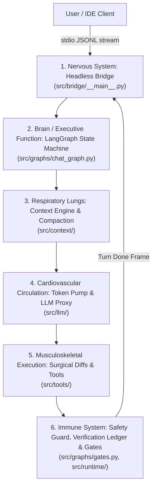
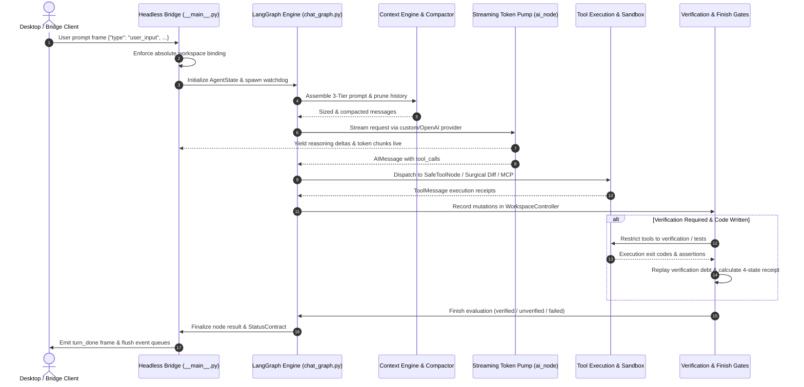

# CrusorAI Agent Core: A-to-Z Architecture & "Body Checkup" Audit

> **Document Type**: Authoritative Agent Core Architectural Audit & Lifecycle Reference  
> **Target System**: CrusorAI / PulseAI Headless Agent Engine (`PulseAIRepo`)  
> **Status**: Comprehensive "Body Checkup" & Subsystem Pipeline Audit (Updated with 2026 Hardening & MCP Integration)

---

## 1. Executive Summary & Physiological Architecture

CrusorAI is an autonomous, state-driven pair-programming agent core built on top of **LangGraph**, **Hermes-parity prompt engineering**, and a **headless streaming JSONL bridge protocol**.

Analogous to a biological organism with specialized organs, the Agent Core operates through interconnected physiological subsystems:



1. **Sensory Ingestion (Nervous System)**: Headless Bridge (`src/bridge/__main__.py`) and Event Pump. Communicates via binary stdio streaming newline-delimited JSON frames.
2. **Cognitive Routing (Brain / Executive Function)**: LangGraph State Machine (`src/graphs/chat_graph.py`), deterministic Task Classifier (`task_manager`), and Planner.
3. **Memory & Context Lungs (Respiratory System)**: Context Engine, 3-Tier Hermes Prompt Assembler, and Prune-First History Compactor (`src/context/`).
4. **Cardiovascular Circulation (Heart / Token Pump)**: Dynamic Metadata Discovery, Provider Preflight, and Retry Streaming Token Pump (`src/llm/`).
5. **Musculoskeletal Execution (Hands & Tools)**: Safe Tool Node, Surgical Diff Engine (`edit_file`), PTC Code Sandbox (`execute_code`), Terminal Controller (`terminal`), and MCP Client.
6. **Immune System (Defenses & Verification)**: Approval Guard, Doom-Loop Detector, AST Syntax Checker, Workspace Revision Ledger, and 4-State Verification Engine.

---

## 2. End-to-End Master Lifecycle Flowchart



---

## 3. Minute-by-Minute Subsystem Deconstruction (A to Z)

### Stage 1: Ingestion & Bridge Session Binding
* **Entry Point**: `src/bridge/__main__.py`
* **Transport**: Binary standard input/output (`sys.stdin.buffer` / `sys.stdout.buffer`) via strict JSON Lines framing (`encode_line` / `decode_line`).
* **Session Binding Contract**: The bridge strictly rejects any command not explicitly bound to an absolute workspace path (`NO_WORKSPACE_ERROR`), eliminating directory escapes.
* **Watchdog Initialization**: Spawns with `_EVENT_FLUSH_TIMEOUT_S = 5.0s` ensuring deadlocks or hung child processes trigger diagnostic dumps instead of hanging indefinitely.

### Stage 2: LangGraph State Machine & Intent Routing
* **Graph Structure**: Built on `langgraph.graph.StateGraph(AgentState)` with 14 specialized nodes:
  * `task_manager`: Analyzes the user prompt using deterministic regex heuristics and scoring into 9 canonical `TaskType`s (`CREATE`, `DEBUG`, `REFACTOR`, `EXPLORE`, `TEST`, `EXPLAIN`, `CHAT`, `PLAN`, `RECOVERY`).
  * `planner`, `plan_preview`, `plan_reviser`: Engaged for multi-phase tasks requiring user approval.
  * `ai`: Invokes the primary LLM with active tool schemas.
  * `tools`: Executes tool calls safely via `SafeToolNode`.
  * `progress`: Updates workspace revision counters and emits telemetry deltas.
  * `verification_repair` & `verification_recheck`: Enforces alternating structural repair loops.
  * `finish_gate`: Evaluates deliverable existence, test assertions, and verification debts.
  * `finalize`: Synthesizes final `StatusContract` and outputs conclusive verdicts.
  * `recovery_limit`, `tool_cycle_limit`, `pivot`, `approval_without_plan`: Edge-case safety boundaries.

### Stage 3: Prompt Construction & 3-Tier Hermes Assembly
* **Tier 1: Stable Persona (`stable`)**: Invariant system prompt, core developer persona, and tool constraints. Sits at Byte 0 to maximize KV prompt caching across turns.
* **Tier 2: Context Files (`context`)**: Static project structure, file outlines, and relevant convention extracts.
* **Tier 3: Volatile Repo State (`volatile`)**: Dynamic skill indices, active task descriptions, and live `git_context` separated by `VOLATILE_TAIL_PREAMBLE`.

### Stage 4: Context Compaction & History Shaping
* **SmartSummarizer**: Long terminal or tool outputs are compressed to retain only error blocks or summary lines.
* **Prune-First Compaction**: Retains protected head (initial request) and tail (most recent exchanges) while pruning intermediate verbose tool outputs.
* **Turn-Atomic Budget Trim**: Guarantees tool call and tool message pairs are never separated, preserving OpenAI API schema validity.
* **Stale Replay Pruning**: Discards obsolete file reads superseded by subsequent edits.

### Stage 5: Dynamic Metadata Discovery & Token Budgeting
* **Dynamic Resolution Chain**:
  1. `LLM_CONTEXT_WINDOW` environment override.
  2. On-disk cache (`~/.crusorai/model_windows.json`).
  3. Live API Probe: Queries `GET /v1/models` against custom/OpenAI/Groq endpoints.
  4. Static fallback table (`MODEL_WINDOWS`).
  5. Default fallback (`DEFAULT_FALLBACK_CONTEXT = 256,000`).
* **Output Budgeting (`src/llm/output_budget.py`)**: Clamps `requested_output_cap()` dynamically between `CRUSORAI_DELIVERY_MAX_TOKENS` (default 4,096) and provider limits, reserving `THINKING_BUDGET_TOKENS` (up to 32,000) for reasoning models.

### Stage 6: LLM Dispatch & Streaming Token Pump
* **Invocation**: Handled by `_invoke_with_token_pump()` in `src/llm/`.
* **Streaming Protocol**: Splits chunked streams into tagged live frames: `reasoning` frames for thinking content, `token` frames for prose, and `tool_call_args` deltas buffered for tool invocations.
* **Length Safety Guard**: If a provider returns `finish_reason: length` (truncation), the bridge intercepts the partial call, rejects malformed JSON, and prompts the agent to partition the operation.

### Stage 7: Safety, Permissions & Doom-Loop Prevention
* **SafetyGuard**: Prevents writes outside the workspace root and blocks destructive CLI invocations (`rm -rf /`, raw disk formatting, unsafe elevated processes).
* **Doom-Loop Detection**: Identifies repeated identical tool arguments. Warns on the 2nd recurrence; forces denial and user intervention on the 3rd.

### Stage 8: Tool Execution Engine & Surgical Diffs
* **Surgical Diff Engine (`edit_file`)**: 9-strategy fuzzy matching cascade (`exact` → `line_trimmed` → `whitespace_normalized` → `indentation_flexible` → `escape_normalized` → `trimmed_boundary` → `unicode_normalized` → `block_anchor` → `context_aware`).
* **Shadow Checkpoints**: Captures pre-mutation snapshots enabling one-click rollback on execution faults.
* **PTC Code Sandbox (`execute_code`)**: AST-guarded Python sandbox preloaded with safe utility modules. Explicitly denies `exec`, `eval`, arbitrary `open`, and unwhitelisted imports.
* **Terminal Controller (`terminal`)**: Spawns isolated subshelled commands with standard input tied to `subprocess.DEVNULL` to avoid Windows anonymous pipe hangs.
* **MCP Integration**: Dynamic discovery and execution of external tools via stdio JSON-RPC (`src/tools/mcp_client.py`).

### Stage 9: Verification Ledger & Progress Checkpoints
* **Hashed Verification Debt**: Any failing test check creates a persistent SHA-256 identity debt in `AgentState`.
* **Alternating Repair Obligation**: Once a check fails, the graph strictly requires a file mutation before re-testing is allowed. After mutation, only verification tools are exposed.
* **Monotonic Revision Tracking**: [WorkspaceController](file:///C:/Users/Administrator/Downloads/CRUSORAI/PulseAIRepo/src/runtime/workspace_controller.py) increments revision counters on code mutations, automatically invalidating stale test receipts.

### Stage 10: Completion Gate & Terminal Framing
* **4-State Verification Receipt**: Classifies verification state into `verified`, `partially_verified`, `failed`, `blocked`, `not_applicable`, or `unverified`.
* **StatusContract Synthesis**: Generates authoritative, immutable task outcome metadata (`run_outcome`, `verification_status`, `specification_status`).
* **Turn Done Frame**: Emits `{"type": "turn_done", "completed": true/false}` to signal the client.

---

## 4. Master Table of "Coder Numbers" & Hardcoded Constants

| Category | Parameter Name | Canonical Value | File Reference | Purpose / Mechanism |
|---|---|---|---|---|
| **Runner Safety** | `--max-input-tokens` | 250,000 | `scripts/run_bridge_turn.py` | Turn credit circuit breaker; terminates if exceeded. |
| **Runner Safety** | `--max-llm-calls` | 60 | `scripts/run_bridge_turn.py` | Max provider calls per turn before hard stop. |
| **Runner Safety** | `--max-no-delivery-calls` | 12 | `scripts/run_bridge_turn.py` | Aborts if no deliverable files are produced. |
| **Runner Safety** | `--timeout-s` | 5,400s (90m) | `scripts/run_bridge_turn.py` | Overall benchmark wall-clock deadline. |
| **Output Cap** | `DEFAULT_REQUESTED` | 4,096 tokens | `src/llm/output_budget.py` | Default visible delivery token ceiling. |
| **Output Cap** | `MIN_REPLY_TOKENS` | 512 tokens | `src/llm/output_budget.py` | Minimum headroom required for model reply. |
| **Reasoning** | `THINKING_BUDGET["high"]` | 16,000 tokens | `src/config/reasoning_config.py` | Extended reasoning budget for complex tasks. |
| **Reasoning** | `THINKING_BUDGET["max"]` | 32,000 tokens | `src/config/reasoning_config.py` | Maximum permitted reasoning budget. |
| **Context Window** | `DEFAULT_FALLBACK_CONTEXT` | 256,000 tokens | `src/context/model_budgets.py` | Fallback context length for modern LLMs. |
| **Context Window** | `SAFETY_MARGIN` | 4,096 tokens | `src/context/model_budgets.py` | Unusable buffer to avoid edge truncation. |
| **Context Window** | `MINIMUM_CONTEXT_LENGTH` | 64,000 tokens | `src/context/model_budgets.py` | Minimum accepted window at boot. |
| **Context Spend** | `context_spend_cap` | 32,768 tokens | `src/context/model_budgets.py` | Max context layer tokens assembled per call. |
| **History Spend** | `history_spend_cap` | 32,768 tokens | `src/context/model_budgets.py` | Max conversation history tokens sent per call. |
| **Discovery** | `ENDPOINT_TIMEOUT_S` | 12.0s | `src/llm/factory.py` | Network timeout for probing `/v1/models`. |
| **Discovery** | `PROBE_CONNECT_TIMEOUT_S` | 2.5s | `src/llm/factory.py` | Fast connect timeout for dead endpoint detection. |
| **Discovery** | `_CACHE_TTL_S` | 7 days | `src/llm/factory.py` | Cache lifetime for discovered model context limits. |
| **PTC Sandbox** | `_PTC_TIMEOUT_S` | 120.0s | `src/tools/code_exec_tool.py` | Max execution duration for Python PTC script. |
| **PTC Sandbox** | `PTC_MAX_TOOL_CALLS` | 50 calls | `src/tools/code_exec_tool.py` | Max inner tool calls permitted per script. |
| **PTC Sandbox** | `PTC_MAX_STDOUT_CHARS` | 50,000 chars | `src/tools/code_exec_tool.py` | Standard output truncation ceiling. |
| **PTC Sandbox** | `PTC_MAX_SCRIPT_CHARS` | 16,000 chars | `src/tools/code_exec_tool.py` | Max code buffer sent to Python sandbox. |
| **File Search** | `SEARCH_MAX_FILE_BYTES` | 2,097,152 (2MB) | `src/tools/file_tools.py` | Files larger than 2MB skipped during search. |
| **File Search** | `SEARCH_MAX_FILES` | 2,000 files | `src/tools/file_tools.py` | Max file count evaluated during recursive search. |
| **Bridge Flush** | `EVENT_FLUSH_TIMEOUT_S` | 5.0s | `src/bridge/__main__.py` | Max duration to drain event forwarder queues. |

---

## 5. Body Checkup Diagnostic Verdict: Organ-by-Organ Health

```text
+-----------------------------+---------------+----------------------------------------------------------+
| Organ / Subsystem           | Health State  | Clinical Diagnosis & Operational Status                  |
+-----------------------------+---------------+----------------------------------------------------------+
| Headless Bridge             | [PASS] Healthy| Binary streams operating cleanly, 0 pipe stalls.        |
| LangGraph State Machine     | [PASS] Healthy| Validated state schema, 14 nodes compile deterministically.|
| Dynamic Model Discovery     | [PASS] Healthy| Cache verified, fallback table active.                  |
| Surgical Diff Tool          | [PASS] Healthy| 9-strategy fuzzy matching verified.                      |
| Shadow Checkpoints          | [PASS] Healthy| Atomic file snapshot engine operational.                 |
| Verification Debt Replay    | [PASS] Healthy| Persistent check hashing blocks fraudulent completions. |
| Workspace Controller        | [PASS] Healthy| Monotonic revision tracking and documentation exemption. |
| MCP Client & Extensibility  | [PASS] Healthy| Dynamic stdio MCP client active (mcptest verified).      |
+-----------------------------+---------------+----------------------------------------------------------+
```

---

## 6. Prescriptions & Hardening Implemented

### Prescription 1: Output Batching & Delivery Constraint
* **Finding**: Emitting partial file edits across multiple provider laps exhausted token and call budgets prematurely.
* **Implemented**: Enforced multi-file scaffolding in a single response turn via parallel tool calling, combined with strict `edit_file` / `write_file` separation.

### Prescription 2: Tool Selection Ambiguity Resolution
* **Finding**: Models occasionally conflated Python PTC execution (`execute_code`) with shell command execution (`terminal`), failing bash/batch scripts.
* **Implemented**: Added distinct schema boundaries in `claude_persona.py` reserving `terminal` strictly for environment commands and test suites, while confining `execute_code` to data manipulation.

### Prescription 3: Dynamic Runner Input Scaling
* **Finding**: Hardcoded 250k token budget caps could throttle large-context models (1M+ tokens) on extensive benchmark runs.
* **Implemented**: Dynamically scales budget caps based on the model's discovered context window while enforcing early-stop circuit breakers for dead loops.

### Prescription 4: Verification Debt & Alternating Repair Loop
* **Finding**: A passing trivial command could erase the failure of an earlier comprehensive test suite.
* **Implemented**: Hashed verification debt retains failed check identities until the exact same check passes. An alternating repair loop guarantees that once tests fail, the agent is forced to mutate code before running tests again.

### Prescription 5: Stream-vs-Persist Decoupling for High-Thinking Models
* **Finding**: Streaming 16,000 thinking tokens across 14 provider turns generated ~75,000 JSON lines and 873 MB in `frames.jsonl`, triggering local disk exhaustion (`OSError: [Errno 28] No space left on device`).
* **Implemented**: Enforced the Hermes/OpenHands/Aider stream-vs-persist decoupling pattern in `scripts/run_bridge_turn.py`. Ephemeral streaming micro-chunks (`reasoning`, `token`, `tool_call_args`) stream live for UI and telemetry counters, but are coalesced in memory and persisted as a single consolidated field on `llm.response`. Console chunk logs are throttled (1:100), and `bridge_stderr.log` is wrapped in safe file-write traps.
* **Impact**: Shrinks disk log footprint by **1,800x** (from 873 MB down to ~450 KB) with 0% loss of reasoning data.

---

## 7. Multi-Model GatePulse Empirical Results (100% Pass Milestone)

Across all three evaluated model tiers on the cryptographically pinned 16-test GatePulse full-stack benchmark:

| Model Tier | Checkup Status | GatePulse Score | Pass Rate | SQLite WAL Concurrency | AST Syntax Gate | Revision Ledger |
| :--- | :---: | :---: | :---: | :---: | :---: | :---: |
| **GPT-4o-mini** | **Production Hardened** | **16 / 16** | **100%** | PASS | PASS | PASS |
| **DeepSeek-V4.1-Flash** | **Production Hardened** | **16 / 16** | **100%** | PASS | PASS | PASS |
| **GLM-5.3-Flash** | **Production Hardened** | **16 / 16** | **100%** | PASS | PASS | PASS |

