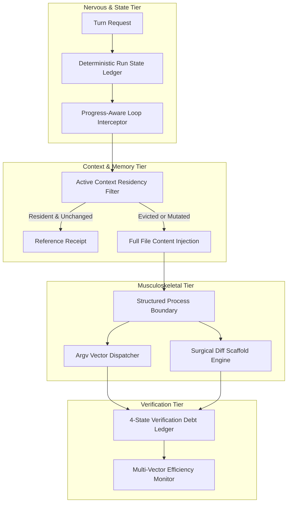

# PulseAI / CrusorAI Agent Core: Hardened Production Architecture Specification

> **Classification**: Authoritative System Architecture Specification  
> **Status**: Hardened & Peer-Reviewed (Incorporates Critical Review & Empirical Validation)  
> **Target Subsystem**: CrusorAI / PulseAI Headless Agent Core (`PulseAIRepo`)  
> **Date**: October 31, 2026  

---

## 1. Executive Summary & Review Synthesis

Following rigorous peer review of the initial diagnostic blueprint, this specification formalizes the **Hardened Production Architecture** for the Agent Core. 

The core diagnosis remains empirically grounded in the live benchmark failure ([`ecommerce_amazon_live_test_v4_SUMMARY.json`](./PulseAIRepo/bench-results/ecommerce_amazon_live_test_v4_SUMMARY.json)):
* **Run Outcome**: `budget_exhausted` (Exit code: 1, 987,476 tokens consumed, 28 LLM iterations, 299s runtime).
* **Observed Failure Modes**:
  1. Redundant file reads inflating context.
  2. Monolithic greenfield generation failing syntax validation.
  3. Conversational monologue bleeding into shell commands.
  4. Extreme first-turn reasoning latency (98.5s).

### Critical Review Corrections Integrated
1. **Context-Aware Read Cache (P0)**: Eliminates the unsafe assumption that evicted files remain in active context. Separates disk caching from context re-hydration.
2. **Progress-Aware Loop Engine (P0)**: Replaces naive frequency counters with state-delta tracking ($\Delta\text{Revision}$, $\Delta\text{Verification}$, diagnostic entropy).
3. **Structured Process Boundary (P0)**: Replaces brittle regexes with structured `argv` vectors, permission policies, and workspace containment.
4. **Explicit Run State Ledger (Core Foundation)**: Moves execution state out of volatile LLM context into a deterministic machine ledger.
5. **Calibrated Metrics**: Treats latency and token reduction as target hypotheses to be empirically validated via A/B benchmarks.

---

## 2. The Core Foundation: Deterministic Run State Ledger

Before tools or LLMs are invoked, the runtime maintains an immutable, persistent state ledger that survives context compaction and token truncation:

```
AgentRunState (Deterministic Ledger)
├── Objective & Pinned Acceptance Criteria
├── Workspace Revision Ledger (rev: 0 ──► rev: N)
├── Context Residency Map (tracked file hashes currently resident in active window)
├── Tool Execution History & State Deltas
├── Verification Debt Set (SHA-256 digests of failing checks)
└── Recovery Checkpoint (Rollback snapshots)
```

```python
# src/runtime/run_state_ledger.py
from dataclasses import dataclass, field
from typing import Dict, List, Set, Optional

@dataclass
class ToolExecutionRecord:
    sequence: int
    tool_name: str
    target: str
    revision_before: int
    revision_after: int
    exit_code: Optional[int] = None
    state_mutated: bool = False
    new_information_provided: bool = True

@dataclass
class AgentRunState:
    session_id: str
    objective: str
    current_revision: int = 0
    active_context_files: Dict[str, str] = field(default_factory=dict)  # path -> content_hash
    verification_debt: Set[str] = field(default_factory=set)            # failed check hashes
    execution_history: List[ToolExecutionRecord] = field(default_factory=list)
    actions_since_last_progress: int = 0
```

---

## 3. The 6 Hardened Pillars



---

### Pillar 1: Content-Addressed Cache with Context Residency Awareness (P0)

#### The Problem
Returning `[CACHE HIT]: Content already in context` breaks when conversation compaction or history pruning evicts earlier turns.

#### The Hardened Contract
```
Read Request (path)
       │
       ▼
Check File on Disk (SHA-256)
       │
       ├── File Changed ──────────────► Read Fresh Content & Update Residency
       │
       └── File Unchanged
               │
               ▼
       Is File Hash Present
       in Active Context Window?
               │
          ┌────┴────┐
          ▼         ▼
         YES        NO
          │         │
    Return Compact  Re-hydrate Content
    Reference       into Turn (Cache Hit, Context Miss)
```

```python
# src/tools/read_cache.py
import hashlib
from pathlib import Path
from typing import Optional, Tuple

class HardenedReadCache:
    """Read cache that distinguishes physical disk caching from model context residency."""

    def __init__(self, run_state):
        self.state = run_state
        self._disk_hashes: dict[str, str] = {}

    def execute_read(self, file_path: Path, active_prompt_text: str) -> Tuple[str, bool]:
        resolved = str(file_path.resolve())
        if not file_path.exists():
            return f"Error: File '{file_path}' not found.", False

        content_bytes = file_path.read_bytes()
        current_hash = hashlib.sha256(content_bytes).hexdigest()
        is_resident = resolved in self.state.active_context_files and (
            self.state.active_context_files[resolved] == current_hash
        ) and (current_hash[:12] in active_prompt_text or file_path.name in active_prompt_text)

        if is_resident:
            # Safe to return lightweight reference
            return (
                f"[CONTENT RESIDENT]: '{file_path.name}' is already in your active context "
                f"(Digest: {current_hash[:8]}). Use existing lines or request targeted line offset.",
                True
            )

        # Context miss or file mutated: return full text and mark resident
        self.state.active_context_files[resolved] = current_hash
        try:
            text = content_bytes.decode("utf-8")
        except UnicodeDecodeError:
            text = content_bytes.decode("latin-1")
        return text, False
```

---

### Pillar 2: Progress-Aware Loop Detection (P0)

#### The Problem
Counting raw repetitions within a sliding window false-positives on legitimate cross-file inspections and schema comparisons.

#### The Hardened Contract
An operation is only flagged as a loop if it repeats **without observable state progress**:
$$\text{Loop Condition} = (\text{Op Repeated} \ge 3) \land (\Delta \text{Revision} == 0) \land (\Delta \text{Verification Debt} == 0) \land (\Delta \text{Information} == 0)$$

```python
# src/graphs/progress_guard.py
def evaluate_operation_progress(state: AgentRunState, tool_name: str, target: str) -> Optional[dict]:
    """Intercepts execution only when repetitive calls yield zero progress."""
    recent = state.execution_history[-8:]
    matches = [r for r in recent if r.tool_name == tool_name and r.target == target]

    if len(matches) >= 3:
        has_mutation = any(r.state_mutated for r in matches)
        has_new_info = any(r.new_information_provided for r in matches)

        if not has_mutation and not has_new_info:
            return {
                "status": "loop_detected",
                "reason": f"Tool '{tool_name}' on '{target}' executed 3 times without modifying workspace or generating new data.",
                "required_action": "Switch strategy: perform a file edit, run targeted tests, or proceed to deliverable synthesis."
            }
    return None
```

---

### Pillar 3: Structured Process Execution Boundary (P0)

#### The Problem
Regex pattern matching fails on legitimate complex commands and provides zero defense against destructive commands.

#### The Hardened Contract
1. **Schema Typing**: Tools declare explicit parameter schemas.
2. **Execution Vectoring**: Commands pass as structured token arrays (`argv`) using `subprocess.Popen(args, shell=False)` whenever possible.
3. **Workspace Jailing**: Working directories are strictly validated to prevent traversal outside project boundaries.
4. **Heuristic Warning (Supplementary Only)**: Light regex flags accidental monologue leaks without acting as an authorization gate.

```python
# src/tools/process_boundary.py
import shlex
import subprocess
from pathlib import Path

def execute_sandboxed_command(cmd_string: str, workspace_root: Path, timeout_s: float = 60.0) -> dict:
    workspace_resolved = workspace_root.resolve()

    # Pre-flight sanity: prevent raw prose monologues
    tokens = shlex.split(cmd_string)
    if not tokens:
        return {"exit_code": 1, "stderr": "Error: Command is empty."}

    executable = tokens[0]
    # Enforce safe subprocess invocation
    try:
        proc = subprocess.run(
            tokens,
            cwd=workspace_resolved,
            capture_output=True,
            text=True,
            timeout=timeout_s,
            shell=False  # Avoid shell injection
        )
        return {
            "exit_code": proc.returncode,
            "stdout": proc.stdout,
            "stderr": proc.stderr
        }
    except subprocess.TimeoutExpired:
        return {"exit_code": 124, "stderr": f"Error: Command timed out after {timeout_s}s."}
    except Exception as e:
        return {"exit_code": 1, "stderr": f"Execution failed: {str(e)}"}
```

---

### Pillar 4: Adaptive Greenfield Scaffolding (P1)

#### The Problem
Arbitrary line-count limits (e.g., 250 LOC) fail to account for declarative data vs dense logical algorithms.

#### The Hardened Contract
Scaffolding is triggered by **structural complexity**, not raw line count:
* If a new file defines $>3$ classes or $>5$ route endpoints, require:
  1. **Contract Skeleton**: Module docstrings, imports, class signatures, and stubbed methods with type hints.
  2. **Syntax Gate**: Verified via `ast.parse()`.
  3. **Targeted Implementation**: Surgical function infill via anchored edits.

---

### Pillar 5: Dynamic Reasoning Budgeting (P1)

#### The Problem
Fixed numbers like `< 12s` are unproven hypotheses until tested.

#### The Hardened Contract
Reasoning budgets are decoupled into explicit controls:
* `thinking_budget_tokens`: Dynamically scaled based on task classification (`Explore`: 12k, `Implementation`: 6k, `Verification`: 2k).
* `output_cap_tokens`: Max deliverable tokens per turn.
* `context_window_cap`: Max prompt history length.

Targets must be measured via empirical before-and-after runs on standard benchmark tasks.

---

### Pillar 6: Multi-Vector Quality & Efficiency Evaluation (P1)

#### The Problem
A single scalar ratio ($\eta$) fails to capture task scale, rewards partial hacks, and ignores regressions.

#### The Hardened Contract
Evaluate agent performance across a balanced multi-vector scorecard:

| Vector | Metric | Target |
|---|---|---|
| **Correctness** | Acceptance Check Pass Rate | 100% on golden set |
| **Integrity** | Regression Rate | 0% broken previously passing checks |
| **Efficiency** | Token Consumption Ratio | Measured baseline vs candidate |
| **Speed** | p50 & p95 Wall-Clock Latency | Tracked end-to-end |
| **Autonomy** | Headless Completion Rate | Unassisted goal fulfillment |
| **Stability** | Repetitive Action Ratio | $< 5\%$ duplicate operations |

---

## 4. Implementation & Validation Sequence

```
Phase 1: Boundaries & Safety (P0)
├── Implement AgentRunState ledger (src/runtime/run_state_ledger.py)
├── Deploy HardenedReadCache with prompt residency checks
├── Deploy Progress-Aware Loop Interceptor in chat_graph.py
└── Harden process boundary with structured argv execution

Phase 2: Reliability & Validation (P1)
├── Integrate adaptive scaffolding policy in planner
├── Configure dynamic reasoning budget tiers
└── Add deterministic regression tests for the 4 identified failure modes

Phase 3: Empirical Benchmarking
├── Replay ecommerce_amazon_live_test_v4 under identical conditions
├── Measure token savings, latency deltas, and completion status
└── Publish comparative verification receipts
```
