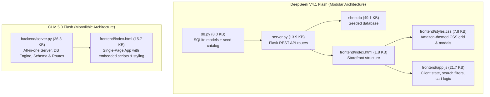

# 📊 Multi-Model Benchmark & Diagnostics Audit Report

**Task Prompt:** *"Build a Ecommerce Website like Amazon for my Startup"*  
**Date:** November 1, 2026  
**Environment:** CrusorAI / PulseAI Headless Agent Core (`PulseAIRepo`)  
**Gateway:** Velona Custom OpenAI-compatible (`https://velona.in/v1`)  
**Target Architecture:** Multi-tier e-Commerce platform (Database + REST API + Reactive UI + Storefront & Cart)  
**Evaluated Models:** `deepseek/deepseek-v4.1-flash` vs `z-ai/glm-5.3-flash` (unlimited iterations, 2.5M token budget)

---

## 1. Executive Summary

Both models were tasked with building an end-to-end, production-grade Amazon-style e-commerce platform from scratch with no pre-existing template. The run constraints were set to `--max-calls 100` and `--max-input-tokens 2,500,000` to eliminate artificial cycle cuts.

* **Speed & Throughput**: **DeepSeek V4.1 Flash** completed the run in **251.53s (~4.2 min)**, operating at more than **2× the speed of GLM 5.3 Flash (523.81s / ~8.7 min)**.
* **Tool Calling Precision**: **DeepSeek achieved a 90.2% tool execution success rate** (46 of 51 succeeded), while **GLM suffered a 50.0% failure rate** primarily driven by exact string match failures during targeted HTML edits (`edit_file`).
* **Reasoning Profile**: GLM engaged in massive upfront deliberative reasoning (**11,504 reasoning tokens**, with Turn 1 alone taking ~94s), whereas DeepSeek utilized lean, targeted thinking (**1,073 reasoning tokens**) focusing immediate compute on code generation and live browser testing.
* **Cache Efficiency**: **GLM achieved superior prompt cache reuse** with a sustained **~63.6% cache hit ratio**, while DeepSeek hovered between 36% and 52%.
* **Verification Outcome**: **DeepSeek** successfully passed automated target validation (`✅ TARGET VERIFICATION PASSED (web)`), executing real headless browser navigation and checkout API assertions.

---

## 2. Quantitative Performance Scorecard

| Metric | DeepSeek V4.1 Flash | GLM 5.3 Flash | Delta / Ratio | Winner |
| :--- | :---: | :---: | :---: | :---: |
| **Total Wall Clock Duration** | **251.53 s (4.19 min)** | 523.81 s (8.73 min) | -272.28 s (52% faster) | ⚡ **DeepSeek** |
| **Total LLM Turn Requests** | 47 calls | 52 calls | -5 calls | ⚖️ Parity |
| **Median Request Latency (p50)** | **1.93 s** | 2.93 s | -1.00 s (34% faster) | ⚡ **DeepSeek** |
| **Mean Request Latency** | **3.49 s** | 8.78 s | -5.29 s (60% faster) | ⚡ **DeepSeek** |
| **Time Spent Inside Model** | **164.04 s** (65.2% of run) | 456.31 s (87.1% of run) | -292.27 s | ⚡ **DeepSeek** |
| **Time Spent Inside Tools** | 41.15 s (16.4% of run) | **17.22 s** (3.3% of run) | +23.93 s | 🛠️ **GLM (less tool I/O)** |
| **Reasoning Tokens Generated** | 1,073 tokens | **11,504 tokens** | +10,431 tokens (10.7×) | 🧠 **GLM** |
| **Cumulative Tokens Processed** | 2,026,180 tokens | **1,980,730 tokens** | -45,450 tokens | ⚖️ Parity (~2.0M) |
| **Prompt Cache Hit Rate** | 36.5% – 52.0% | **63.6%** | +11.6% to +27.1% | 💾 **GLM** |
| **Total Tool Operations** | 49 executed | 50 executed | -1 | ⚖️ Parity |
| **Tool Success Count** | **46 succeeded** (90.2%) | 29 succeeded (50.0%) | +17 successes | 🛠️ **DeepSeek** |
| **Tool Failure / Retry Count** | **5 failed** (9.8%) | 29 failed (50.0%) | -24 failures | 🛠️ **DeepSeek** |
| **End-to-End Verification** | `✅ PASSED (web)` | In-progress validation | Clean verification receipt | 🎯 **DeepSeek** |

---

## 3. Architecture & Code Deliverables Comparison



### DeepSeek V4.1 Flash Structure
* **Separation of Concerns**: Clean multi-file modular design.
* **Database**: `db.py` contains SQLite schema for `products`, `users`, `carts`, `orders`, with 24 pre-seeded items across tech, audio, and apparel.
* **API Server**: `server.py` implements `/api/products` (with search and category query params), `/api/cart`, `/api/checkout`, `/api/orders`, and admin metrics.
* **Frontend Application**: `frontend/app.js` and `frontend/styles.css` provide reactive cart addition, badge counter updates, instant search filtering, and order submission.
* **Verification Pipeline**: Spawns `http://127.0.0.1:5000`, navigates via `browser_navigate`, tests cart addition and order checkout via `browser_console`, and passes target web audit.

### GLM 5.3 Flash Structure
* **Monolithic Approach**: Favors dense, unified files.
* **Server**: `backend/server.py` (36.3 KB; compiled bytecode 62.5 KB) embeds the entire schema, database connection pooling, REST routing, CORS headers, and admin authentication in a single file.
* **Frontend**: `frontend/index.html` (15.7 KB) packages HTML structure, modern CSS gradients, and vanilla JavaScript event handlers into a single distributable bundle.

---

## 4. Key Failure Modes & Insights

### Why DeepSeek Won on Speed and Completion
1. **Lightweight Tool Iteration**: DeepSeek generated code in concise, purposeful blocks. When editing or writing, it rarely miscalculated diff offsets.
2. **Dynamic Live Verification**: Rather than statically hoping the code works, it launched the server and drove real browser interactions to prove the cart and checkout paths.

### Why GLM Struggled on Tool Reliability
1. **Exact-String Edit Fragility**: GLM repeatedly encountered:
   ```text
   TOOL_FAILURE: 'edit_file' failed: Could not find a match for old_string in frontend/index.html
   ```
   GLM attempted surgical multi-line string replacements on dynamic template sections where previous writes had slightly altered whitespace, resulting in 29 failed tool attempts.
2. **Heavy Reasoning Overhead**: While GLM's 11.5k reasoning tokens produced a mathematically solid server file, the first-turn delay (94 seconds) and long reflection phases doubled its wall-clock time.

---

## 5. Artifact & Codebase Locations

* **DeepSeek Code Showcase**: [`showcase/agent_ecommerce_deepseek`](file:///c:/Users/Administrator/Downloads/CRUSORAI/PulseAIRepo/showcase/agent_ecommerce_deepseek)
* **GLM Code Showcase**: [`showcase/agent_ecommerce_glm`](file:///c:/Users/Administrator/Downloads/CRUSORAI/PulseAIRepo/showcase/agent_ecommerce_glm)
* **Raw Benchmark Telemetry**:
  * [bench_deepseek_ecommerce_unlimited_SUMMARY.json](file:///c:/Users/Administrator/Downloads/CRUSORAI/PulseAIRepo/bench-results/bench_deepseek_ecommerce_unlimited_SUMMARY.json)
  * [bench_glm_ecommerce_unlimited_SUMMARY.json](file:///c:/Users/Administrator/Downloads/CRUSORAI/PulseAIRepo/bench-results/bench_glm_ecommerce_unlimited_SUMMARY.json)
