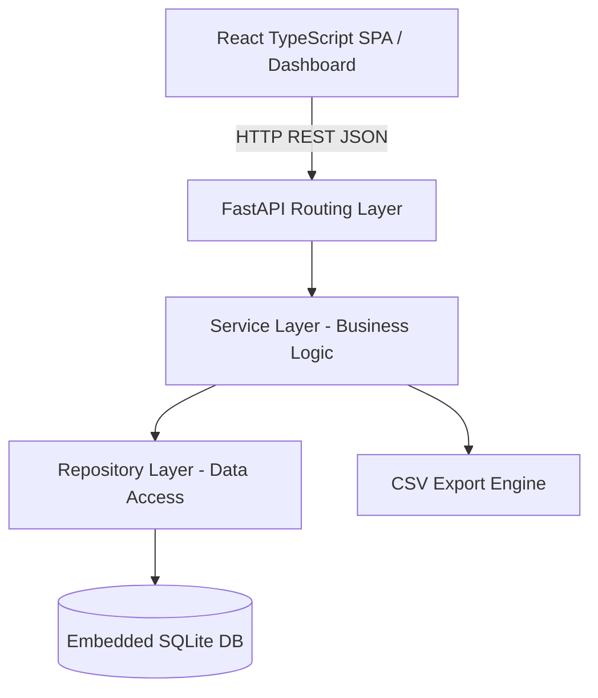

# PERSONAL FINANCE MANAGEMENT APPLICATION — ARCHITECTURE BLUEPRINT & IMPLEMENTATION PLAN

**Specification Reference:** `SPEC-FINANCE-2026-001` (v2 APPROVED)  
**Architecture Pattern:** Modular Monolith  
**Runtime:** Local-First Python FastAPI + React TypeScript  
**Persistence:** Embedded SQLite (WAL Mode)  
**Currency:** Indian Rupees (INR — ₹)  

---

## 1. ARCHITECTURE LAYERS & DESIGN

The application is structured into strict decoupled layers following the Modular Monolith pattern:

### Layer Responsibilities:
1. **API Routing Layer (`src/finance_app/routers/`):**
   - Pure HTTP endpoint definitions, request validation via Pydantic, HTTP status codes (200, 201, 204, 400, 404, 422).
   - Endpoints:
     - `/api/transactions`: GET (filter by month, category, payment mode), POST (create), PUT (update), DELETE (remove)
     - `/api/categories`: GET (list all), POST (create custom)
     - `/api/budgets`: GET (list monthly budgets), POST/PUT (set limit)
     - `/api/dashboard`: GET (aggregated KPIs, cash flow, category breakdowns)
     - `/api/export/csv`: GET (download CSV file)
     - `/health`: Health check probe

2. **Service Layer (`src/finance_app/services/`):**
   - Business rule enforcement:
     - Non-negative, non-zero amount checks
     - Automatic category validation
     - Financial calculations using fixed 2-decimal arithmetic
     - Budget threshold calculations (percentage spent, budget exceeded alerts)
     - CSV formatting with RFC 4180 escaping

3. **Repository Layer (`src/finance_app/repositories/`):**
   - Direct SQLite access using parameter-binding (preventing SQL injection)
   - Connection management with row factory dict mapping
   - Foreign key constraint enforcement (`PRAGMA foreign_keys = ON`)
   - WAL journaling (`PRAGMA journal_mode = WAL`) for concurrent read/write performance

4. **Persistence Layer (`src/finance_app/database.py`):**
   - Embedded SQLite database at `data/personal_finance.db`
   - Automatic table schema migration and seed initialization on startup

5. **Frontend Layer (`src/finance_app/frontend/`):**
   - Modern React with TypeScript
   - Modular views: DashboardView, TransactionsView, BudgetsView
   - Interactive SVG/Canvas charts for category breakdown and monthly cash flow
   - Direct CSV download trigger

---

## 2. CHANGE IMPACT ANALYSIS (PHASE 11.4)

* **Repository Blast Radius:**
  - Zero modifications to existing Crusor agent core files (`src/orchestration`, `src/intelligence`, `src/production`).
  - Zero modifications to `desktop/` (Invariant 7 fully preserved).
  - New isolated module directory: `src/finance_app/`.
  - New test file: `src/tests/test_finance_app.py`.
* **Potential Risks Identified:**
  - Port conflicts: default FastAPI port 8000; configurable via environment.
  - Floating point drift: resolved by rounding all monetary aggregations to 2 decimal places.
  - Date timezone drift: all timestamps stored in ISO 8601 UTC / standard YYYY-MM-DD.

---

## 3. TEST BASELINE (PHASE 11.5)

Before introducing the finance app, existing system baseline test suite contains 485 tests passing 100%.
The new test suite `src/tests/test_finance_app.py` must achieve 100% pass across:
1. Category listing and default seeding
2. Transaction creation (income & expense)
3. Transaction editing and deletion
4. Input validation (negative amounts, invalid dates, missing fields)
5. Monthly budget creation and progress calculation
6. Dashboard aggregations (income, expenses, net savings, savings rate)
7. Monthly filtering and category filtering
8. CSV export format and escaping
9. Concurrent transactions and balance consistency

